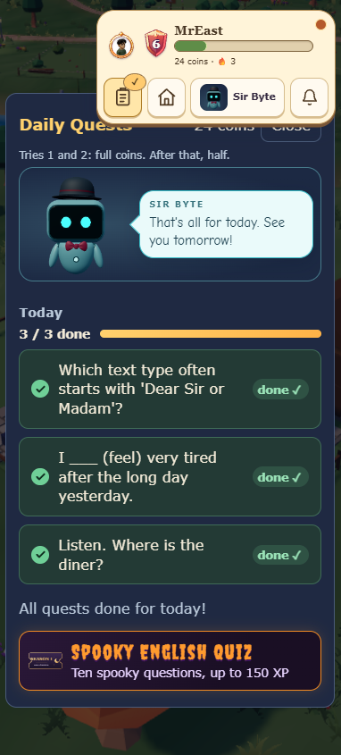
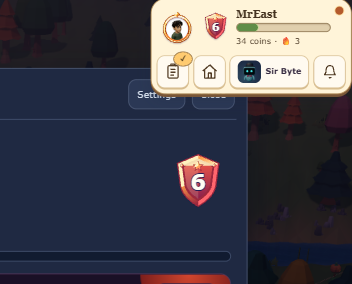
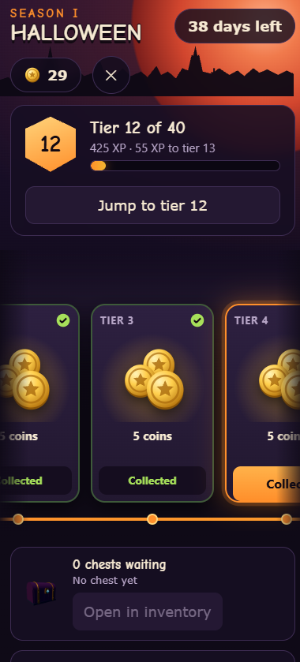
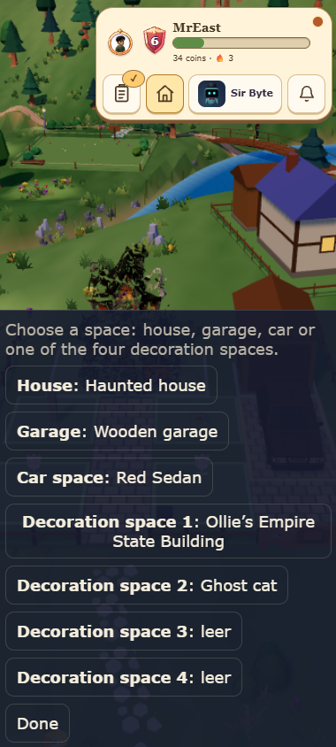
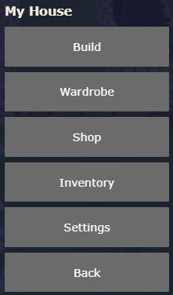
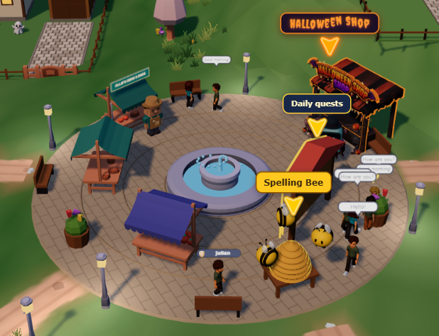
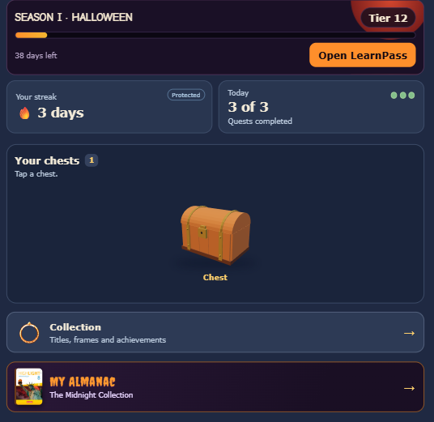
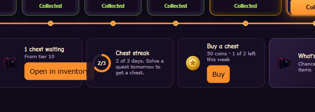
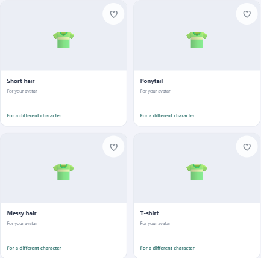
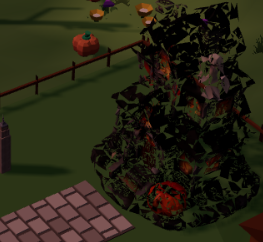

# Lerndorf – Bugregister

Stand: 29.10.2026 · **10 Befunde · 2 UI/UX-Vorhaben · 1 Eingang (unvollständig)**

> Jeder Fehler bekommt eine ID, einen Steckbrief und – sobald beauftragt –
> ein Fix-Paket in `handoff/`. Bilder liegen unter `bilder/`.

> **Als nächstes zu fixen:** BUG-009 (nach Review von BUG-005). BUG-001 committet (70add80).

## Übersicht

| ID | Titel | Ort | Schwere | Aufwand | Status | Fix-Paket |
|---|---|---|---|---|---|---|
| [BUG-001](#bug-001--smartphone-hud-überdeckt-die-kopfzeile-der-daily-quests) | Smartphone: HUD überdeckt die Kopfzeile der Daily Quests, „Schließen“ praktisch unerreichbar (auch Profil/Settings) | Dorf → Aufgaben / Profil | **S2** | **S** | **Fix da** | [FIX-01](handoff/FIX-01.md) |
| [BUG-002](#bug-002--learnpass-münzen-einsammeln-friert-die-seite-ein) | Learnpass: Münzen einsammeln friert die Seite ein (Hard Reset nötig) | Season-Pass / Learnpass | **S1** | **L** | **Fix da** (Abnahme am Gerät offen) | [FIX-02](handoff/FIX-02.md) |
| [BUG-003](#bug-003--learnpass-ansicht-zu-groß-für-smartphones) | Learnpass-Ansicht zu groß für Smartphones, Karten links/rechts angeschnitten | Season-Pass / Learnpass | **S3** | **M** | **Fix da** | [FIX-02](handoff/FIX-02.md) |
| [BUG-004](#bug-004--scrollen-im-learnpass-ruckelt) | Scrollen im Learnpass ruckelt / fühlt sich verbuggt an | Season-Pass / Learnpass | **S3** | **M** | **Fix da** (Abnahme am Gerät offen) | [FIX-02](handoff/FIX-02.md) |
| [BUG-005](#bug-005--bau-modus-feldauswahl-verdeckt-das-dorf-direkter-klick-auf-gebäudedeko-fehlt) | Bau-Modus: Feldauswahl verdeckt das Dorf, direkter Klick auf Gebäude/Deko fehlt | Dorf → Bauen | **S3** | **M** | **Fix da** | [FIX-03](handoff/FIX-03.md) |
| [BUG-007](#bug-007--season-hub-almanac-direkt-unter-season-1) | Season-Hub: My Almanac steht unten – soll direkt unter Season 1 | Season-Hub / Almanac | **S3** | **S** | **Fix da** | [FIX-04](handoff/FIX-04.md) |
| [BUG-008](#bug-008--learnpass-open-in-inventory-button-überlappt-die-karte) | Learnpass: „Open in inventory“-Button überlappt die Kartenkante / stößt an die nächste Karte | Learnpass / Chests | **S3** | **S** | **Fix da** | [FIX-05](handoff/FIX-05.md) |
| [BUG-009](#bug-009--inventar-platzhalter-gegenstände-mit-falschem-icon) | Inventar: Platzhalter-Gegenstände (Haare/T-Shirt) mit falschem T-Shirt-Icon | Inventar / Kleiderschrank | **S3** | **M** | bestätigt | [FIX-06](handoff/FIX-06.md) |
| [BUG-010](#bug-010--spelling-bee-zu-schwer) | Spelling Bee: zu schwer – leichter, mehr Buchstaben zur Auswahl, 3 Joker, Wörter aus der Unit | Dorf → Spelling Bee | **S3** | **M** | bestätigt | [FIX-07](handoff/FIX-07.md) |
| [BUG-011](#bug-011--legendäres-hausmodell-ersetzen) | Legendäres Hausmodell rendert als schwarze/grüne Masse – durch angehängtes Fantasy-Treehouse-GLB ersetzen | Dorf / Hausplatz | **S3** | **M** | bestätigt | [FIX-08](handoff/FIX-08.md) |

## UI/UX-Vorhaben (keine Fehler)

| ID | Vorhaben | Ort | Aufwand | Status | Konzept |
|---|---|---|---|---|---|
| [UX-001](#ux-001--haus-menü-uiux-überarbeitung) | Haus-Menü komplett überarbeiten: Hierarchie, Icons, Status, mobil + Desktop | Mein Haus | **L** | Konzept | [UI-01](handoff/UI-01.md) · [Mockup](konzepte/haus-menu.html) |
| [UX-002](#ux-002--marktplatz-layout-und-shop-marker) | Marktplatz größer, Aufgaben/Shops entzerren, Ollie-Silhouette + Pfeil, Shop-UI kleiner | Dorf → Marktplatz | **L** | Konzept | [UI-02](handoff/UI-02.md) · [Layout](konzepte/marktplatz-layout.svg) |

**Eingang (noch nicht bewertet):** [BUG-006 – Season-Pass-Kachel](#bug-006--season-pass-kachel-meldung-unvollständig)

## Legende

- **Schwere:** S1 Blocker · S2 Hoch · S3 Mittel · S4 Niedrig · S5 Kosmetik
- **Aufwand:** S ≤ 30 Min · M 0,5–2 Std · L 2–6 Std · XL > 1 Tag
- **Status:** neu · bestätigt · Fix beauftragt · Fix da · abgenommen · zurückgewiesen

---

## BUG-001 – Smartphone: HUD überdeckt die Kopfzeile der Daily Quests



| Feld | Inhalt |
|---|---|
| **Ort** | Dorf → Aufgaben (Daily Quests) und Profil/Settings, Hochformat |
| **Schweregrad** | **S2 – Hoch** |
| **Aufwand** | **S – ≤ 30 Min** (CSS; Fallback M, siehe unten) |
| **Häufigkeit** | immer im Hochformat auf dem Handy; auf schmalen Desktop-Fenstern, sobald Panel und HUD sich horizontal überschneiden |
| **Gerät/Browser** | Screenshots 382 × 845 und 352 × 284 px; Browser nicht angegeben |
| **Status** | **Fix da** (29.10.2026, wartet auf Review; Build lokal nicht prüfbar, siehe Notiz) |
| **Bild** | `bilder/BUG-001_01.png`, `bilder/BUG-001_02.png` |
| **Fix-Paket** | [FIX-01](handoff/FIX-01.md) |

### Weiterer Fundort: Profil/Settings (29.10.2026)



Gleiche Überlappung auf der Profil-/Settings-Ansicht (352 × 284 px): Die
Knöpfe „Settings“ und „Close“ liegen unter der zweiten HUD-Zeile; „Close“
ist fast vollständig verdeckt. Damit ist bestätigt: Es ist kein
Daily-Quests-Spezialfall, sondern die gemeinsame Overlay-Kopfzeile.

Der Fix aus FIX-01 muss **beide** Stellen abdecken – Daily Quests und
Profil/Settings. Die gleiche CSS-Regel wird von allen nicht-modalen
Overlays genutzt.

### Änderungsnotiz (Fix da, 29.10.2026)

- **Datei:** `web/src/style.css`, Regel `.overlay:not(.modal)` (Zeile ~515).
- **Ursache:** wie oben belegt, reservierter Abstand 92 px aus der einzeiligen HUD-Version; im Browser nachgestellt (382 × 845, UI M): HUD-Unterkante 139 px, Panel-Oberkante 104 px, also 35 px Überdeckung.
- **Fix:** Variante A: `padding-top: calc(max(12px, env(safe-area-inset-top)) + 146px * var(--ui))`. Sonst nichts geändert. Profil, Aufgaben und Shop nutzen alle `overlay area` und damit dieselbe Regel.
- **Messung (Testseite mit echter `createGameNav` + `.overlay`, danach gelöscht):** Panel-Oberkante minus HUD-Unterkante: 382 × 845 M +4 px (vorher −35), 360 × 800 S +5, 390 × 844 L +4, 430 × 932 M +4, 352 × 284 M +4, 1280 × 800 S +5; „Close“ vollständig sichtbar, kein horizontaler Scroll. XS und L bei 1280 nicht gemessen (nur Sichtprüfung der Formel).
- **Nicht geprüft:** die echten Ansichten Profil/Settings und Shop mit Anmeldung (kein Login in der Prüfumgebung); die Regel ist dieselbe.
- **Tests:** `npm test` 219 Dateien / 1317 Tests grün. **`npm run build` schlägt lokal fehl** mit `esbuild-transpile … remove …\Temp\esbuild-… Access is denied`; derselbe Fehler tritt auch auf dem unveränderten Stand (HEAD) und im eigenen Terminal auf, hängt also nicht an diesem Fix. `tsc --noEmit` läuft durch.
- **Screenshot:** [bilder/BUG-001_03.jpg](bilder/BUG-001_03.jpg) (JPG statt PNG, vom Screenshot-Werkzeug).

### Beobachtung (Ist)

Auf dem Smartphone liegt die obere Leiste (Avatar „MrEast“, Level, Münzen,
Aufgaben-/Haus-Knopf, „Sir Byte“, Glocke) über der Kopfzeile der
Daily-Quests-Ansicht:

- Der Titel wird nach „Daily Ques“ abgeschnitten; der Rest liegt unter dem HUD.
- „27 coins“ ist nur noch als angeschnittenes Stück zu sehen.
- Der Knopf „Close“ liegt fast vollständig unter dem HUD. Sichtbar bleibt nur
  ein schmaler Streifen am unteren Rand – kein nutzbares Touch-Ziel.
- Ein Tipp auf die Stelle trifft das HUD, nicht den Knopf. Die Ansicht lässt
  sich dadurch nicht schließen.
- Der Knopf „Aufgaben“ ist bereits aktiv. Erneutes Tippen schließt die Ansicht
  nicht, weil `areas.select('aufgaben')` bei bereits geöffneter Area ein
  No-op ist.
- Auch Escape hilft nicht: Es schließt nur die Haus-Ansicht.

Die Quests selbst sind bedienbar; das Problem ist die verdeckte Kopfzeile und
der fehlende reguläre Ausweg.

### Erwartung (Soll)

- Das Panel beginnt **vollständig unterhalb** des HUD.
- Titel, Münzzahl und „Schließen“ sind sichtbar und mit dem Finger erreichbar.
- „Schließen“ führt zurück ins Dorf.
- Kein Überlappen von HUD und Panel-Kopfzeile – unabhängig von UI-Größe
  (S/M/L) und Gerätebreite.

### Schritte zum Nachstellen

1. Lerndorf im Hochformat öffnen (z. B. 382 × 845 px, wie im Screenshot).
2. Sicherstellen, dass das HUD oben rechts sichtbar ist (Avatar + vier Knöpfe).
3. Auf „Aufgaben“ tippen, sodass die Daily Quests erscheinen.
4. Kopfzeile beobachten: Titel, „27 coins“ und „Close“ liegen unter dem HUD.
5. Auf „Close“ tippen → das HUD fängt den Tipp ab; die Ansicht bleibt offen.

### Messwerte aus dem Screenshot

| Element | Position (px) |
|---|---|
| HUD | x ≈ 112–376, y ≈ 8–137 |
| Panel-Oberkante | y ≈ 100 |
| Panel-Kopfzeile | y ≈ 118–145 |
| Überdeckung | ca. **37 px** vertikal |
| HUD-Ebene | `z-index: 21` |
| Overlay-Ebene | `z-index: 20` |

### Ursache (statisch geprüft, nicht im Browser nachgestellt)

1. **Der reservierte Abstand ist zu klein.** `.overlay:not(.modal)` setzt
   oben nur `92px` plus Safe Area. Das Panel beginnt damit bei ca. 104 px
   (`web/src/style.css:512-516`).
2. **Das HUD ist inzwischen zweizeilig.** Aus 8 px Innenabstand + 68 px
   Statuskarte + 6 px Gap + 48 px Knopfreihe + 8 px Innenabstand ergibt sich
   eine Höhe von **138 px** bei UI-Zoom 1
   (`web/src/ui/gameNav.css:2-17`, `:22-35`, `:50-63`).
3. **Der UI-Zoom verkleinert das HUD.** Standard ist `--ui: 0.9`; damit ist
   das HUD ca. 124 px hoch und endet bei ca. 136 px
   (`web/src/style.css:1366-1386`).
4. **Es fehlen genau die 54 px der zweiten Zeile** (48 px Knopf + 6 px Gap).
   Die 92 px stammen noch von der einzeiligen HUD-Version.
5. **Das HUD liegt über dem Overlay.** `z-index: 21` gegen `20`; dadurch
   gehen Tipps auf die verdeckte Kopfzeile an das HUD
   (`web/src/style.css:518-522` gegen `:141-151`).
6. **Es gibt keinen zweiten Ausweg.** „Schließen“ ist der einzige
   Schließen-Knopf (`web/src/ui/dailyQuestsView.ts:80`, `:84-85`);
   `areas.select` ignoriert dieselbe Area (`web/src/ui/areas.ts:56-60`);
   Escape schließt nur `haus` (`web/src/ui/villageView.ts:198-201`).

### Fix-Vorschlag (nur für die nächste KI – **nicht umgesetzt**)

**A – CSS, empfohlen (Aufwand S):** Den Abstand an die echte HUD-Höhe
koppeln, inklusive Zoom:

```css
.overlay:not(.modal) {
  padding-top: calc(max(12px, env(safe-area-inset-top)) + 146px * var(--ui));
}
```

146 px = 138 px HUD + 8 px Luft. `var(--ui)` berücksichtigt die
UI-Größen S/M/L. Danach Shop, Profil und Aufgaben bei 360/382/430 px prüfen.

**B – robuster, falls die HUD-Höhe variiert (Aufwand M):** Die Unterkante
von `nav.game-nav` per `ResizeObserver` messen, als CSS-Variable
(`--hud-bottom`) setzen und `.overlay:not(.modal)` mit
`padding-top: calc(var(--hud-bottom) + 8px)` arbeiten lassen. Nötig, wenn
lange Namen oder Umbruch die HUD-Höhe verändern.

**Nicht tun:** HUD `z-index` senken (dann überdeckt das Panel die Leiste),
HUD ausblenden oder die Daily-Quests-Kopfzeile umbauen. Das behebt nur das
Symptom und bricht die einheitliche Bedienung.

### Abnahmekriterien

- [ ] Bei 382 × 845 px liegt die Panel-Oberkante mindestens 4 px unter der
      HUD-Unterkante.
- [ ] „Daily Quests“, „27 coins“ und „Close“ sind vollständig sichtbar.
- [ ] „Close“ ist mit dem Finger erreichbar und schließt die Ansicht
      (zurück ins Dorf).
- [ ] Bei 360 × 800, 390 × 844 und 430 × 932 px dasselbe Ergebnis.
- [ ] Bei UI-Größe S, M und L (Einstellungen) kein neuer Überlapp.
- [ ] Profil/Settings: „Settings“ und „Close“ sind vollständig sichtbar und
      klickbar (352 × 284 px).
- [ ] Shop-Overlay (gleiche CSS-Regel) bleibt korrekt.
- [ ] Kein horizontaler Scroll, Panel bleibt zentriert.
- [ ] `cd web && npm test` grün.
- [ ] `cd web && npm run build` grün.
- [ ] Screenshot nach dem Fix als `bilder/BUG-001_03.png`.

### Aufwandsschätzung – Begründung

**S (≤ 30 Min):** eine CSS-Deklaration in `web/src/style.css`, danach drei
Viewports und die UI-Größen prüfen. Kein Datenmodell, keine Logik, keine
Migration. Wird die HUD-Höhe gemessen statt gerechnet (Variante B), sind es
eher **M** (0,5–2 Std), weil `gameNav.ts` und ein ResizeObserver dazukommen.

---

## BUG-002 – Learnpass: Münzen einsammeln friert die Seite ein

| Feld | Inhalt |
|---|---|
| **Ort** | Season-Pass / Learnpass („Season I Halloween“), Smartphone |
| **Schweregrad** | **S1 – Blocker** |
| **Aufwand** | **L – 2–6 Std** (mobile-only Freeze; Ursache muss erst reproduziert werden) |
| **Häufigkeit** | mindestens einmal; ob zuverlässig reproduzierbar, ist offen |
| **Gerät/Browser** | Screenshot 380 × 839 px; Gerät und Browser nicht angegeben |
| **Status** | **Fix da** (29.10.2026, wartet auf Review und Test am Gerät) |
| **Bild** | `bilder/BUG-002_01.png` |
| **Fix-Paket** | [FIX-02](handoff/FIX-02.md) |

### Änderungsnotiz (Fix da, 29.10.2026)

- **Ursache (im Browser nachgestellt, Harness `dev/learnpass-ui.html`, 380 × 839):** Wer eine Stufe abholt, die eine Sammelkarte vergibt, bekommt direkt danach das Karten-Fenster (`revealCards`, ein `openModal` mit `z-index: 45`). Der LearnPass liegt mit `z-index: 60` darüber. Das Karten-Fenster öffnet sich also **hinter** dem Pass und macht ihn gleichzeitig `inert` (`ui/dialog.ts`). Ergebnis: Der Pass sieht normal aus, reagiert auf nichts mehr, das unsichtbare Fenster ist nicht erreichbar (Escape gibt es auf dem Handy nicht) – es wirkt wie ein Freeze, nur ein Neuladen hilft. Gemessen: Overlay-z 45, Pass-z 60, Pass `inert`, `elementFromPoint` trifft den Pass.
- **Dieselbe Ursache, zweite Stelle:** „Zum Almanach“ im Karten-Fenster öffnet den Almanach (ebenfalls Modal, z 45) hinter dem noch offenen Pass.
- **Fix:** (1) `web/src/collection/cardReveal.css`: `.overlay.modal.reveal-overlay { z-index: 70 }` (über dem Pass; die Karten-Hinweiszeile `cardNotice` nutzt ebenfalls 70). (2) `web/src/ui/learnpass/openLearnPass.ts`: „Zum Almanach“ schließt zuerst den Pass, wie „Im Inventar öffnen“. Keine Änderung an Münz-/Karten-RPCs oder Daten.
- **Nachher geprüft:** Karten-Fenster liegt sichtbar über dem Pass, „Next“ schließt es, der Pass ist danach nicht mehr `inert`.
- **Tests:** neuer Test in `tests/ui/openLearnPassLifecycle.test.ts`; `npm test` 219 Dateien / 1318 Tests grün, `tsc --noEmit` grün. `npm run build` lokal weiterhin wegen „Access is denied“ im Temp-Ordner nicht prüfbar (siehe BUG-001).
- **Wichtig / offen:** Die Meldung nennt nur „Münzen einsammeln“; ich habe den Freeze im Harness über den Karten-Pfad nachgestellt (Münz-Stufen vergeben laut H9 Sammelkarten). Dass genau das die Ursache auf dem Gerät war, ist sehr wahrscheinlich, aber **nicht auf dem Gerät bestätigt**. Ein Münz-Collect ohne Karte hängt im Harness nicht. Bitte am Handy an einer Stufe mit Karte prüfen; reduzierte Bewegung nicht getrennt getestet.
- **Nachtrag 29.10.2026 (Rückmeldung der Lehrkraft):** Beim Abholen fror die Seite weiter ein, solange der Ton lief – das Karten-Fenster (Ton „mystery“, 3D-Karte) sperrt die ganze Seite einige Sekunden. Änderung: Nach dem Abholen erscheint nur noch ein **Hinweis zum Antippen** („New trading cards: … Tap to view“, `cardNotice`); der Pass bleibt dabei bedienbar und scrollbar (im Browser geprüft: Track scrollt, Pass nicht `inert`). Das Karten-Fenster mit Ton öffnet sich erst auf Tipp. **Das ändert das Verhalten der Karten-Enthüllung (bisher automatisch) – bitte bestätigen oder zurückmelden.** Dateien: `collection/cardNotice.ts`, `ui/learnpass/openLearnPass.ts`, `i18n/en.ts`, Tests angepasst/ergänzt; `npm test` 1319 grün.
- **Nachtrag 2 (29.10.2026, Rückmeldung der Lehrkraft):** Der Hinweis erschien am unteren Bildschirmrand und wurde von den Schülern nicht gesehen. Er steht jetzt **direkt unter „What's inside?“** im Pass (breit, leuchtend, bleibt bis zum Tippen, scrollt sich ins Bild; `cardNotice.ts` Option `host`, `cardNotice.css`, `openLearnPass.ts`). Außerdem wird der Hinweis vor dem Neuladen des Pass-Zustands gezeigt. Geprüft bei 380 und 1032 px im Harness; Tests grün.
- **Bilder:** [vorher](bilder/BUG-002_02_vorher.jpg) (Karten-Fenster unsichtbar, Pass eingefroren), [nachher](bilder/BUG-002_03_nachher.jpg).

### Beobachtung (Ist)

Beim Einsammeln von Münzen im Learnpass reagiert die Seite nicht mehr. Der
Nutzer musste hart neu starten (Tab/App schließen); ein normales Schließen
der Ansicht war nicht mehr möglich. Offen ist, ob die Münzen vor dem Freeze
noch gutgeschrieben wurden und ob der Zustand nach dem Neustart stimmt.

Das angehängte Bild zeigt den Screen **vor** dem Freeze; der eingefrorene
Zustand selbst ist auf einem Standbild nicht zu sehen.

### Erwartung (Soll)

- Der Tap auf die Münz-Aktion sammelt die Münzen ein.
- Die Seite bleibt bedienbar; es erscheint eine Rückmeldung (Münzen, Ton,
  Animation), die auch wieder endet.
- Kein Neuladen, kein Hard Reset, kein doppelter Münzgewinn.

### Schritte zum Nachstellen (so gemeldet)

1. Learnpass öffnen (Season I Halloween).
2. Münzen einsammeln (Tap auf die Münz-/Collect-Aktion).
3. Seite friert ein; nur Hard Reset hilft.

**Noch offen (bitte beim Fix zuerst klären):**

- Welcher Tap genau? (Karte, „Collected“, Sammel-Knopf, Chest?)
- Passiert es immer oder nur manchmal?
- Gerät/Browser/Version?
- War vorher eine Animation, ein Ton oder ein Dialog zu sehen?
- Passiert es auch mit `prefers-reduced-motion` oder bei stummer App?

### Vermutung (nicht im Code geprüft)

- Eine Animation oder ein „Celebration“-Overlay endet nie und blockiert die
  Bedienung.
- Eine Scroll-/Fokus-Sperre (`inert`, `overflow: hidden`) wird nach dem
  Einsammeln nicht wieder gelöst.
- Ein RPC/State-Update wartet auf etwas, das nie zurückkommt (Netzwerk,
  Retry, Promise-Kette).
- Doppel-Tap/Race: Der zweite Tap startet eine zweite Aktion, während die
  erste noch läuft.

Diese Punkte sind **Hypothesen**. Die Fix-KI soll zuerst reproduzieren und
die Konsole/Performance prüfen, bevor sie etwas ändert.

### Abnahmekriterien

- [ ] Münzen einsammeln funktioniert auf dem Smartphone ohne Freeze.
- [ ] Die Seite bleibt danach bedienbar; Schließen und Scrollen gehen.
- [ ] Münzen werden genau einmal gutgeschrieben (kein Doppelgewinn).
- [ ] Keine Konsolenfehler, keine hängenden Timer/Promises.
- [ ] Test mit mindestens einem echten Mobilgerät oder Emulation
      (380 × 839) und mit reduzierter Bewegung.
- [ ] `cd web && npm test` und `npm run build` grün.

### Aufwandsschätzung – Begründung

**L (2–6 Std):** Der Fehler ist mobil, nicht deterministisch beschrieben und
kann in Animation, Fokus-/Scroll-Sperre oder Netzwerk-State liegen. Erst
reproduzieren, dann eingrenzen; ein Blind-Fix wäre riskant. Ist die Ursache
im Debugger sofort sichtbar, kann es **M** werden.

---

## BUG-003 – Learnpass-Ansicht zu groß für Smartphones



| Feld | Inhalt |
|---|---|
| **Ort** | Season-Pass / Learnpass, Hochformat |
| **Schweregrad** | **S3 – Mittel** (falls Tiers horizontal nicht erreichbar sind: S2) |
| **Aufwand** | **M – 0,5–2 Std** |
| **Häufigkeit** | immer auf dem Smartphone (380 × 839 px) |
| **Gerät/Browser** | Screenshot 380 × 839 px; Browser nicht angegeben |
| **Status** | **Fix da** (29.10.2026) |
| **Bild** | `bilder/BUG-002_01.png` |
| **Fix-Paket** | [FIX-02](handoff/FIX-02.md) |

### Änderungsnotiz BUG-003 (Fix da, 29.10.2026)

- **Datei:** `web/src/ui/learnpass/learnpass.css`, Block `@media (max-width: 860px)`.
- **Nachgestellt (Harness `dev/learnpass-ui.html`, 380 × 839):** Der X-Knopf stand in einer zweiten Kopfzeile neben der Münzzahl (`.lp-head` mit `flex-wrap`), über der Kartenreihe lag viel Leerraum (Track `min-height: 330px` + 36 px Innenabstand).
- **Fix:** Kopfzeile als Grid: Titel und X oben (X am rechten Rand), „days left“ und Münzen darunter; Track `min-height: 0` und oben 24 px Innenabstand. Karten und Desktop-Layout unverändert.
- **Gemessen:** 360 × 800, 380 × 839, 430 × 932: X rechts oben (z. B. 380: x 316–364, y 16), kein horizontaler Überlauf (`scrollWidth` = Viewportbreite), Desktop 1280 unverändert. Die angeschnittenen Nachbarkarten links/rechts sind das gewollte „Peek“ der wischbaren Kartenreihe (Rand 16 px, Track scrollt horizontal); die Karten selbst habe ich nicht verkleinert. Der untere Bereich ist durch Scrollen der Seite erreichbar (Seitenhöhe 1186 px bei 839 px Fenster).
- **Bild:** [bilder/BUG-003_02.jpg](bilder/BUG-003_02.jpg)

### Beobachtung (Ist)

Auf dem Smartphone wirkt der Learnpass zu groß für den Viewport:

- Die Reihe der Tier-Karten ist links und rechts angeschnitten. Die linke
  Karte beginnt außerhalb des Bildes (nur „6 coins“ und ein Teil von
  „Collected“ sind zu sehen), die rechte Karte endet mitten im Text
  („Collec…“).
- Zwischen „Jump to tier 12“ und der Kartenreihe steht viel Leerraum; der
  Inhalt wirkt nach unten geschoben.
- Der untere Bereich („0 chests waiting“, „Open in inventory“) liegt weit
  unten und wirkt am unteren Rand abgeschnitten.
- Der X-Knopf sitzt nicht am rechten Rand, sondern neben der Münzzahl; das
  wirkt gegenüber der sonstigen Kopfzeile verschoben.

Ob die Kartenreihe horizontal scrollbar ist, ist offen. **Falls die Karten
nicht erreichbar sind, ist das nicht mehr S3, sondern S2** (ganze Tiers
unerreichbar).

### Erwartung (Soll)

- Die Ansicht passt in die Breite des Geräts; kein Element ragt aus dem
  Viewport.
- Die Tier-Karten sind vollständig sichtbar oder sauber horizontal
  scrollbar – mit Rand, nicht abgeschnitten.
- Der X-Knopf ist oben rechts sichtbar und erreichbar.
- Der untere Bereich ist ohne Überlappung erreichbar.
- Kein horizontales Scrollen der ganzen Seite.

### Schritte zum Nachstellen

1. Learnpass im Hochformat öffnen (380 × 839 px).
2. Kartenreihe und unteren Bereich ansehen.
3. Prüfen, ob die Karten horizontal erreichbar sind.
4. Gerät drehen / kleinere Breite (360 px) testen.

### Vermutung (nicht im Code geprüft)

- Feste Breiten/Höhen oder `min-width` im Modal oder Karten-Rail.
- Der Karten-Rail hat keinen seitlichen Innenabstand und ragt bewusst über
  den Rand; auf dem Phone wirkt das wie abgeschnitten.
- UI-Zoom (`--ui`) oder Safe-Area-Padding ist für kleine Breiten nicht
  angepasst.
- Die Kopfzeile ist ein anderes Grid als die übrigen Ansichten; dadurch
  sitzt der X-Knopf versetzt.

### Abnahmekriterien

- [ ] Bei 360 × 800, 380 × 839 und 430 × 932 px ragt nichts aus dem Viewport.
- [ ] Alle Tiers sind erreichbar (sichtbar oder horizontal scrollbar).
- [ ] X-Knopf ist oben rechts sichtbar und schließt den Learnpass.
- [ ] Unterer Bereich (Chest/Inventory) ist vollständig erreichbar.
- [ ] Kein horizontales Scrollen der Seite; nur der Karten-Rail scrollt
      horizontal.
- [ ] Screenshot nach dem Fix als `bilder/BUG-003_02.png`.

### Aufwandsschätzung – Begründung

**M (0,5–2 Std):** mehrere Elemente (Kopfzeile, Rail, unterer Bereich) und
drei Viewports; wahrscheinlich CSS, aber mit Sichtprüfung auf echten
Geräten. Wenn nur ein Container-Padding fehlt, eher **S**.

---

## BUG-004 – Scrollen im Learnpass ruckelt

| Feld | Inhalt |
|---|---|
| **Ort** | Season-Pass / Learnpass, Smartphone |
| **Schweregrad** | **S3 – Mittel** |
| **Aufwand** | **M – 0,5–2 Std** |
| **Häufigkeit** | beim Scrollen im Learnpass selbst; wie stark, ist offen |
| **Gerät/Browser** | Screenshot 380 × 839 px; Browser nicht angegeben |
| **Status** | **Fix da** (29.10.2026, Abnahme am Gerät offen) |
| **Bild** | `bilder/BUG-002_01.png` |
| **Fix-Paket** | [FIX-02](handoff/FIX-02.md) |

### Änderungsnotiz BUG-004 (Fix da, 29.10.2026)

- **Ursache:** `.lp-track` hatte `touch-action: pan-x`. Die Kartenreihe ist auf dem Handy rund 340–356 px hoch (über 40 % des Bildschirms); ein senkrechter Wisch, der dort beginnt, kann die Seite nicht scrollen. Das fühlt sich wie hängendes, ruckelndes Scrollen an. Im Browser gemessen: `touch-action: pan-x`.
- **Fix:** `touch-action: pan-x pan-y` (horizontal scrollt weiter nur die Reihe, `overscroll-behavior-x: contain` bleibt).
- **Nicht geprüft:** echtes Touch-Verhalten (die Emulation sendet Mausereignisse) und Bildrate auf einem Gerät. Schwere Effekte (`backdrop-filter`) habe ich nicht angefasst; falls es am Gerät noch ruckelt, wären sie der nächste Kandidat.

### Beobachtung (Ist)

Das Scrollen **im Learnpass selbst** fühlt sich nicht flüssig an und wirkt
verbuggt. Gemeint ist die Learnpass-Ansicht (Season-Pass), **nicht** die
Dorf-Seite dahinter. Offen ist nur, ob zusätzlich die Kartenreihe eigene
Horizontal-Gesten hat und ob sich beide Richtungen in die Quere kommen.

_Präzisiert am 29.10.2026 nach deiner Rückmeldung: „scrollen im lernpass aber!“_

**Eigener Befund:** BUG-004 ist nicht nur eine Folge von BUG-003 (zu groß).
Auch nach einem Layout-Fix muss das Scrollen im Learnpass erneut geprüft
werden; nicht als Duplikat schließen.

### Erwartung (Soll)

- Vertikales Scrollen im Learnpass scrollt ruhig und ohne Springen.
- Die Kartenreihe scrollt nur horizontal, wenn man sie horizontal zieht.
- Keine hängenden Gesten, kein Doppel-Scroll, kein Ruckeln durch schwere
  Effekte.

### Schritte zum Nachstellen

1. Learnpass im Hochformat öffnen.
2. Im Learnpass selbst langsam vertikal scrollen (nicht die Dorf-Seite
   dahinter); beobachten, ob es springt oder hängt.
3. Auf der Kartenreihe horizontal ziehen; beobachten, ob die Seite
   mitgeht.
4. Mit reduzierter Bewegung (`prefers-reduced-motion`) wiederholen.

### Vermutung (nicht im Code geprüft)

- Verschachtelte Scroll-Container (Modal + Karten-Rail + Seite).
- Schwere Hintergrund-Effekte (Blur/Schatten/Animationen) während des
  Scrollens.
- Fehlendes `touch-action` / `overscroll-behavior`; dadurch werden Gesten
  falsch zugeordnet.
- Der Freeze aus BUG-002 und das Ruckeln haben dieselbe Ursache (z. B.
  hängende Scroll-Sperre).

### Abnahmekriterien

- [ ] Vertikales Scrollen im Learnpass fühlt sich flüssig an (kein sichtbares Springen).
- [ ] Kartenreihe scrollt horizontal, ohne die Seite vertikal mitzunehmen.
- [ ] Kein Scrollen bleibt hängen; keine toten Zonen.
- [ ] Mit `prefers-reduced-motion` ebenfalls benutzbar.
- [ ] Screenshot/Video nach dem Fix als `bilder/BUG-004_02.png`.

### Aufwandsschätzung – Begründung

**M (0,5–2 Std):** Scroll-Container und Gestenzuordnung prüfen, auf dem
Gerät testen. Wenn die Ursache dieselbe wie BUG-002 ist, wird es mit diesem
Fix günstiger; wenn Rendering/Blur die Ursache ist, eher **L**.

---

## BUG-005 – Bau-Modus: Feldauswahl verdeckt das Dorf, direkter Klick auf Gebäude/Deko fehlt



| Feld | Inhalt |
|---|---|
| **Ort** | Dorf → Bauen (Build mode), Smartphone |
| **Schweregrad** | **S3 – Mittel** (Bedienung stark erschwert, aber über die Liste möglich) |
| **Aufwand** | **M – 0,5–2 Std** (UI; **L**, falls die 3D-Auswahl erst gebaut werden muss) |
| **Häufigkeit** | immer im Bau-Modus auf dem Smartphone |
| **Gerät/Browser** | Screenshot 380 × 844 px; Browser nicht angegeben |
| **Status** | **Fix da** (29.10.2026) |
| **Bild** | `bilder/BUG-005_01.png` |
| **Fix-Paket** | [FIX-03](handoff/FIX-03.md) |

### Änderungsnotiz (Fix da, 29.10.2026)

- **Befund beim Lesen des Codes:** Der direkte Tap existiert schon: `BuildMode.handleTap` trifft per Raycast auf die Plätze des eigenen Grundstücks und wählt sie aus (`web/src/render/buildMode.ts`). Das Problem war die Platzliste (`slotList`): sieben Knöpfe mit Langtext („Decoration space 1: Ollie’s Empire State Building“) füllten den halben Bildschirm.
- **Fix (nur Darstellung, keine Bau-Logik):** Die Liste ist jetzt eine Chip-Leiste: sichtbar kurze Beschriftung („House · Garage · Car + · Deco 1 · Deco 2 + …“), leere Plätze gestrichelt mit „+“; der volle Name („Decoration space 2: leer“) bleibt der zugängliche Name (`sr-only`), also bleiben Tastatur/Screenreader und die E2E-Namen gleich. Hinweistext kürzer: „Tippe im Dorf auf einen Platz oder wähle hier:“. Dateien: `buildMode.ts`, `style.css` (`.build-chip*`), `i18n/en.ts`.
- **Gemessen (380 × 844, Wegwerf-Seite mit der echten `BuildMode`-Leiste und Fake-Daten):** Leiste 247 px hoch (vorher rund 490 px), Dorfansicht 71 % des Bildschirms (Soll ≥ 50 %), „Fertig/Done“ sichtbar. Der Ablauf nach der Auswahl (Editor-Sheet, Aufstellen, Drehen, Wegräumen) ist unverändert.
- **Nicht geprüft:** der echte Tap auf 3D-Objekte im Dorf auf einem Touch-Gerät (Logik unverändert; die Dorf-Testseite `dev/build.html` ließ sich in dieser Umgebung nicht bis in den Bau-Modus bedienen), 360 × 800 und 430 × 932 (Chips umbrechen, gleiche Regel), Desktop 1280 (nur Tests).
- **Tests:** neuer Test in `tests/ui/buildBar.test.ts`; `npm test` 219 Dateien / 1323 Tests grün; `tsc` grün; Build weiter lokal blockiert.
- **Bild:** [bilder/BUG-005_02.jpg](bilder/BUG-005_02.jpg)

### Beobachtung (Ist)

Im Bau-Modus erscheint unten eine Liste aller Bauplätze („Choose a space …“).
Auf dem Smartphone nimmt sie **deutlich mehr als die untere Hälfte** ein:
Sie beginnt bei ca. y = 355 von 844 px und reicht bis zum unteren Rand.

- Die 3D-Ansicht bleibt nur ca. 355 px hoch; das Objekt, das man ändern
  will, kann hinter der Liste liegen.
- Die Liste enthält **alle** Plätze, auch leere („Decoration space 3: leer“,
  „Decoration space 4: leer“), und sieben gleich große Knöpfe plus „Done“.
- Ein direkter Tap auf das Gebäude oder die Deko in der 3D-Ansicht ist
  nicht als Weg erkennbar; man muss den passenden Eintrag in der Liste
  suchen.
- Auf kleineren Geräten wird die Liste selbst zum Scrollen; „Done“ rutscht
  nach unten.

Gewünscht (Nutzer): **direkt auf das zu ändernde Gebäude oder die Deko
tippen** – die große Liste ist dafür zu viel.

### Erwartung (Soll)

- Ein Tap auf ein Gebäude/eine Deko in der 3D-Ansicht wählt dieses Objekt
  direkt zum Ändern aus (mit sichtbarer Markierung).
- Die Liste ist nur noch **Fallback** für leere Plätze oder als kompakte
  Auswahl (Chips/kleine Leiste), nicht als halber Bildschirm.
- Die 3D-Ansicht bleibt mindestens zur Hälfte sichtbar; „Done“ ist immer
  erreichbar.
- Kein versehentliches Verschieben/Platzieren beim Auswählen.

### Schritte zum Nachstellen

1. Im Dorf den Bau-Modus öffnen.
2. Die untere Liste beobachten: Sie verdeckt den Großteil des Dorfes.
3. Versuchen, ein Gebäude/eine Deko direkt in der 3D-Ansicht anzutippen.
4. Feststellen, dass nur die Liste zum Ziel führt.

### Vermutung (nicht im Code geprüft)

- Die Feldauswahl ist als Bottom-Sheet für alle Plätze gebaut (Desktop-
  Muster), ohne Touch-Hit-Testing auf die 3D-Objekte.
- Es gibt noch keine Auswahl „Objekt antippen → Editor öffnen“; die Liste
  ist der einzige Einstieg.
- Leere Plätze werden mit aufgelistet, obwohl sie in der 3D-Ansicht besser
  über den Boden erreichbar wären.

### Fix-Idee (für FIX-03, **nicht umgesetzt**)

1. **Direktauswahl:** Tap/Raycast auf belegte Bauplätze; Objekt hervorheben,
   dann den bestehenden Editor öffnen.
2. **Leere Plätze:** über den Boden antippen oder eine kompakte Chip-Leiste
   („House · Garage · Car · Deko 1–4“), nicht die volle Liste.
3. **Fallback:** Liste einklappbar, max. 2–3 Zeilen, „Done“ sticky; nur
   öffnen, wenn der Tap nicht eindeutig ist.
4. **Barrierefreiheit:** Tastatur-/Screenreader-Fallback über die Liste
   behalten.

### Abnahmekriterien

- [ ] Bei 360 × 800, 380 × 844 und 430 × 932 px bleibt die 3D-Ansicht
      mindestens zur Hälfte sichtbar.
- [ ] Tap auf ein belegtes Gebäude/eine Deko wählt es direkt aus und öffnet
      den Editor.
- [ ] Leere Plätze sind ohne die große Liste erreichbar (Boden-Tap oder
      kompakte Chips).
- [ ] „Done“ ist immer sichtbar/erreichbar.
- [ ] Kein versehentliches Platzieren/Verschieben beim Auswählen.
- [ ] Bestehende Bau-, Preis- und Besitzlogik unverändert.
- [ ] `cd web && npm test` und `npm run build` grün.
- [ ] Screenshot nach dem Fix als `bilder/BUG-005_02.png`.

### Aufwandsschätzung – Begründung

**M (0,5–2 Std):** Die Auswahl-UI und die Tap-Zuordnung ändern, ohne die
Bau-Logik anzufassen; drei Viewports prüfen. Muss die 3D-Auswahl
(Raycasting, Highlight, leere Plätze) erst neu gebaut werden, sind es
**L** (2–6 Std).

---

## UX-001 – Haus-Menü: UI/UX-Überarbeitung

> **Kein Fehler**, sondern eine Gestaltungsaufgabe. Deshalb steht UX-001
> außerhalb der Bug-Wertung (kein S1–S5).



### Ausgangslage

Das aktuelle Menü ist eine schmale Liste aus sechs gleich großen grauen
Knöpfen: Build, Wardrobe, Shop, Inventory, Settings, Back. Es funktioniert,
wirkt aber wie ein Systemmenü, nicht wie „mein Haus“:

- **Keine Hierarchie:** Bauen, Kleiderschrank, Shop, Inventar, Einstellungen
  und Zurück sehen alle gleich aus; „Back“ ist genauso schwer wie „Build“.
- **Keine Icons, keine Untertitel:** Die Bedeutung der Knöpfe erschließt sich
  nur über das Wort; jüngere Schüler lesen langsamer.
- **Kein Status:** Man sieht nicht, ob neue Gegenstände, eine Truhe oder ein
  Kleidungsstück warten.
- **Keine Haus-Identität:** Kein Name, kein Level, kein Bild – nur eine Liste.
- **Viel toter Raum:** Die schmale Spalte nutzt den Platz nicht; auf dem
  Smartphone entstehen lange, monotone Blöcke.
- **Kein „Zuhause“-Gefühl:** Das Dorf ist warm und handgebaut, das Menü kalt
  und grau.

### Ziel

1. In **zwei Sekunden** klar: Was kann ich tun, was ist neu, wie komme ich
   zurück?
2. **Primäre Aktionen** (Bauen, Kleiderschrank, Shop, Inventar) von
   **Sekundärem** (Einstellungen, Zurück) trennen.
3. **Status auf einen Blick** – ohne jeden Bereich zu öffnen.
4. Es soll sich wie **mein Haus** anfühlen, nicht wie eine Einstellungsliste.
5. **Mobil und Desktop** gut: unten ein schwebendes Schild, auf Desktop eine
   Seitentafel – keine volle Bildschirmliste.
6. **Barrierefrei:** 44-px-Ziele, Fokus, reduced motion, nicht nur Farbe.

### Konzept: „Porch light“

Ein schwebendes **Hausschild** über dem Dorf – kein Vollbild-Menü.

- **Kopf:** Messing-Medaillon mit Haus-Symbol, darüber „MY HOUSE“, Titel
  **„Home, sweet home“**, darunter „Level 6 · 12 items“.
- **Signatur – die Veranda-Lampe:** eine kleine Messinglaterne an der
  Oberkante des Schilds. Sie glüht warm, wenn etwas wartet (Truhe, neue
  Gegenstände), mit kleiner Zahl. Das ist das eine wiedererkennbare Element;
  alles andere bleibt ruhig.
- **2 × 2 „Raum-Karten“** statt sechs Zeilen:
  - **Build** – „Expand & decorate“ (hervorgehoben, weil es der Hauptweg ist)
  - **Wardrobe** – „Your look“
  - **Shop** – „Furniture & decor“
  - **Inventory** – „12 items“, Badge „3“ für Neues
  Jede Karte: Icon im Messing-Feld, Titel, Untertitel, Chevron.
- **Fuß:** „Settings“ als leiser Sekundär-Knopf, **„Back to the village“**
  als klarer Messing-Knopf. Zurück ist immer erreichbar.
- **Mobil:** schwebende Karte mit 14 px Rand, unten, ca. 400 px hoch – das
  Dorf bleibt oben sichtbar. Keine Vollbild-Liste.
- **Desktop:** 380-px-Seitentafel rechts, 24 px Rand; gleiche Inhalte, keine
  gestreckte Liste.

### Gestaltungs-Tokens

| Rolle | Wert |
|---|---|
| Nacht / Hintergrund | `#0a1120` |
| Schild | `#182135` → `#111a2b` |
| Karte | `#202c45` → `#18233a` |
| Messing | `#e2b25c` / `#c58f37` |
| Text | `#f7eeda` |
| Muted | `#a9b1c2` |
| Neu / Erfolg | `#7fcf8f` |
| Lampe | `#ffb547` |

**Schrift:** Comic Neue (bereits im Projekt, für Titel und Kartenlabels) +
Verdana/Atkinson Hyperlegible (Fließtext). Keine neuen Fonts.

**Form:** 26-px-Schild, 16-px-Karten, 1-px-Linien, weiche Schatten; die
Messingkante oben zitiert die HUD-Ränder, ohne sie zu kopieren.

### Bewegung und Barrierefreiheit

- Schild fährt in 220 ms ein, Karten staffeln 25 ms; Lampe glimmt alle 3 s
  sanft (nur wenn etwas wartet).
- `prefers-reduced-motion`: keine Staffelung, kein Glimmen.
- Fokus: 3-px-Ring in `#ffb547`, sichtbar auf jeder Karte.
- Badges haben Text/aria-label, nicht nur Farbe.
- Karten sind `<button>`, keine `<div>`-Klickflächen.

### Mockup

[`konzepte/haus-menu.html`](konzepte/haus-menu.html) – statisches
HTML/CSS-Mockup (380 × 844), **keine App-Logik**. Im Browser öffnen; auf
Desktop erscheint es in einem Phone-Rahmen. Es ist eine Richtung, kein
pixelgenauer Screenshot der App.

### Abnahmekriterien

- [ ] Bei 380 × 844 und 1280 × 800: alle sechs Aktionen erreichbar.
- [ ] Primär (4 Karten) und sekundär (Settings/Back) sind klar getrennt.
- [ ] Jede Karte hat Icon, Titel und Untertitel; Back ist der stärkste
      Knopf unten.
- [ ] Status (Items/Neu/Truhe) ist sichtbar, ohne einen Bereich zu öffnen;
      fehlende Daten werden ausgeblendet, nicht erfunden.
- [ ] 44-px-Touchziele, Tastaturfokus, `prefers-reduced-motion`.
- [ ] Keine Änderung an Aktionen, Preisen, Besitz oder Daten.
- [ ] Screenshot nach der Umsetzung als `bilder/UX-001_02.png`.

### Aufwand

**L (2–6 Std):** Markup/CSS des Menüs, vier Icons, responsives Verhalten,
Status-Anbindung, Fokus/Reduced-Motion, Tests. **XL**, wenn eine
Haus-Illustration oder eine 3D-Vorschau dazukommt – für den ersten Wurf
nicht nötig.

---

## UX-002 – Marktplatz-Layout und Shop-Marker

> **Kein Fehler**, sondern eine Welt-/UI-Gestaltungsaufgabe. Deshalb keine
> S1–S5-Wertung.



| Feld | Inhalt |
|---|---|
| **Ort** | Dorf → Marktplatz |
| **Aufwand** | **L – 2–6 Std** (Layout + Marker); **XL**, wenn die Platzgeometrie neu generiert werden muss |
| **Status** | Konzept |
| **Bild** | `bilder/UX-002_01.png` |
| **Fix-Paket** | [UI-02](handoff/UI-02.md) |

### Ausgangslage

Der Marktplatz ist ein runder Platz mit Brunnen in der Mitte. Stände,
Quest-Tafel und Marker stehen dicht am Rand; die Wege zwischen Brunnen und
Ständen sind eng.

- **Zu eng:** Der Brunnen nimmt die Mitte, die Stände drängen sich am Rand;
  Figuren und Stände überlappen optisch.
- **Marker überlappen:** „Daily quests“ und „HALLOWEEN SHOP“ liegen dicht
  beieinander, „Spelling Bee“ direkt daneben. Die gelben und orangen Pfeile
  konkurrieren um denselben Bereich.
- **Ollie's Shop ohne Marker:** Der Stand links hat (wenn überhaupt) nur ein
  Schild, aber keine schwebende Silhouette und keinen Pfeil wie die anderen.
- **Shop-UI zu groß:** Labels und Pfeile sind im Verhältnis zu den Figuren
  sehr groß; sie dominieren das Bild und verdecken Stände.
- **Aufgaben und Shops gemischt:** Lernorte und Verkaufsstände liegen
  durcheinander; das Auge findet keine Ordnung.

### Ziel

1. **Platz größer:** mindestens +25 % Radius, breiterer begehbarer Ring
   zwischen Brunnen und Ständen.
2. **Aufgaben und Shops trennen:** eine Lernseite (Daily Quests, Spelling Bee)
   und eine Marktseite (Ollie's Market, Halloween Shop).
3. **Ollie's Shop bekommt Silhouette + Pfeil** im gleichen System wie die
   anderen, aber mit eigener Farbe.
4. **Shop-UI kleiner:** Labels/Pfeile auf ca. 60–70 % der jetzigen Fläche;
   lesbar bleiben, nicht overlapping.
5. **Kamera:** der ganze Platz mit allen Markern ist auf 618 × 474 und
   1280 × 800 erfassbar.

### Layout-Vorschlag

[Layout-Skizze](konzepte/marktplatz-layout.svg) (Draufsicht, nicht maßstabsgetreu).

- **Brunnen** bleibt Mitte; begehbarer Ring mindestens 2,5 m breit.
- **Lernseite (links/Westen):**
  - Daily Quests bei ca. 10 Uhr
  - Spelling Bee bei ca. 8 Uhr
- **Marktseite (rechts/Osten):**
  - Ollie's Market bei ca. 2 Uhr
  - Halloween Shop bei ca. 4 Uhr
- Zwischen den Ankern mindestens 2,5 m Abstand; keine zwei Marker dürfen
  sich auf dem Bildschirm überdecken.
- Die Uhrzeiten sind ein Vorschlag. Wenn der Seed/Die Weltgenerierung die
  Positionen vorgibt: innerhalb der Zonen verschieben, nicht exakt am
  Zifferblatt kleben.

### Ollie's Marker

- **Silhouette:** Markttasche oder Ollie-Kopf/ Hut als schwarze Silhouette
  auf einem kleinen Holzschild – gleiche Familie wie der Halloween-Marker.
- **Pfeil:** teal/grün, gleiche Formsprache, aber ca. 30 % kleiner als der
  Halloween-Pfeil.
- **Label:** „OLLIE'S MARKET“, 12–13 px, max. 140 px breit.
- **Verhalten:** Tap/Hover öffnet den Shop; keine Kollision mit dem
  Daily-Quests-Marker.

### Shop-UI kleiner

- Einheitlicher Marker: Icon-Scheibe (ca. 28 px) + Label + Pfeil.
- Label 12–13 px, Padding 6–8 px, Pfeil 20–24 px, max. 140 px Breite.
- Farben: Aufgaben = Laterne/Gelb, Ollie = Teal/Grün, Halloween = Orange.
- Screen-Space-Kollisionsvermeidung: Labels verschieben, notfalls ausblenden,
  wenn sie hinter der Kamera oder zu weit weg sind.
- Auf Mobilgeräten nur die nächsten 2–3 Labels zeigen, Rest als kleine
  Icon-Punkte – optional, wenn es sonst zu eng bleibt.
- Kontrast und Mindestgröße nicht unterschreiten (Lesbarkeit vor Optik).

### Abnahmekriterien

- [ ] Platzradius mindestens +25 %; begehbarer Ring ≥ 2,5 m; keine Kollision
      mit Ständen/Figuren.
- [ ] Daily Quests und Spelling Bee liegen auf der Lernseite, Ollie und
      Halloween auf der Marktseite.
- [ ] Ollie's Shop hat Silhouette **und** Pfeil und ist von den anderen
      Markern unterscheidbar.
- [ ] Bei 618 × 474 und 1280 × 800 überdecken sich keine zwei Labels/Pfeile.
- [ ] Shop-Marker sind ca. 60–70 % der jetzigen Größe; Label ≥ 12 px.
- [ ] Jeder Marker öffnet weiterhin die richtige Ansicht.
- [ ] Galerie/Screenshots zeigen den ganzen Platz; keine Figur steht im
      Brunnen oder in einem Stand.
- [ ] `cd web && npm test`, `npm run build`, `npm run galerie` grün.
- [ ] Screenshot nach der Umsetzung als `bilder/UX-002_02.png`.

### Aufwand

**L (2–6 Std):** Platzparameter/Ankerpositionen verschieben, Marker-System
verkleinern, Ollie-Marker ergänzen, Galerie prüfen. **XL (> 1 Tag)**, wenn
die Platzgeometrie, Wege oder Kollisionen neu generiert werden müssen und
die Welt deterministisch neu aufgebaut wird.

---

## BUG-006 – Season-Pass-Kachel (Meldung unvollständig)

> **Eingang, noch nicht bewertet.** Die Meldung endet bei „Season pa…“.
> Bitte ergänzen, was genau falsch ist – sonst keine Schwere/Aufwand.


| Feld | Inhalt |
|---|---|
| **Ort** | Season-Pass / Learnpass (genaue Stelle offen) |
| **Schweregrad** | — (offen) |
| **Aufwand** | — (offen) |
| **Status** | Eingang |
| **Bild** | `bilder/BUG-006_01.png` |

### Sichtbar

- 96 × 72 px große Kachel mit goldenem Rahmen.
- Innen ein Ticket: „SEASON I“, darunter „HALLOWEEN“ (sehr klein und
  verwaschen), rechts eine Mondsichel.
- Darunter das Label „Season I“.
- Die Kachel wirkt wie ein Thumbnail; die Innenbeschriftung ist bei dieser
  Größe kaum lesbar.

### Offene Fragen

- Ist die Kachel **zu klein**, **unscharf**, **abgeschnitten** oder steht
  dort der falsche Text?
- Fehlt „Pass“ („Season pa…“)?
- Wo genau erscheint sie: Learnpass, Almanach, Shop, Startseite?
- Gerät/Browser und Bildschirmgröße?

Ohne diese Angaben wird BUG-006 **nicht** in die Bewertung aufgenommen.

---

## BUG-007 – Season-Hub: Almanac direkt unter Season 1



| Feld | Inhalt |
|---|---|
| **Ort** | Season-Hub / „My Almanac“ (Season I · Halloween) |
| **Schweregrad** | **S3 – Mittel** (Inhalt erreichbar, aber falsch einsortiert) |
| **Aufwand** | **S – ≤ 30 Min** (Karte verschieben, keine Logik) |
| **Häufigkeit** | immer |
| **Gerät/Browser** | Screenshot 536 × 521 px; Browser nicht angegeben |
| **Status** | **Fix da** (29.10.2026) |
| **Bild** | `bilder/BUG-007_01.png` |
| **Fix-Paket** | [FIX-04](handoff/FIX-04.md) |

### Änderungsnotiz (Fix da, 29.10.2026)

- **Ort geklärt:** Der „Season-Hub“ aus dem Screenshot ist die Profil-Ansicht (`web/src/ui/profileView.ts`), nicht das Season-Ticket im Dorf (dessen Willkommens-Fenster wurde heute entfernt, siehe PLAN J2).
- **Fix:** Die bestehende „Mein Almanach“-Karte wird direkt nach der Season-Karte eingefügt (vorher am Ende nach „Sammlung“). Gleiche Komponente, gleiche DOM-Reihenfolge (kein CSS `order`), Text/Design/Klickziel unverändert.
- **Gemessen (Harness `dev/profile.html?view=profil`, 536 × 521):** Fortschrittsbalken y 343 → Almanach 397 → Serie/Heute 480 → Truhen 581 → Sammlung 864. Die Season-Karte kommt im Code unmittelbar davor (im Harness nicht eingebunden).
- **Tests:** neuer Test in `tests/ui/profileView.test.ts` (Reihenfolge und Klick); `npm test` grün; `tsc` grün; Build weiter lokal blockiert.
- **Bild:** [bilder/BUG-007_02.jpg](bilder/BUG-007_02.jpg)

### Beobachtung (Ist)

Die Reihenfolge im Season-Hub ist aktuell:

1. Season I · Halloween (Titel, Fortschritt, „Open LearnPass“)
2. Your streak / Today
3. Your chests (Chest)
4. Collection
5. **My Almanac** („The Midnight Collection“) – ganz unten

Die Almanac-Karte steht damit am Ende der Seite, weit weg vom Season-1-Kopf.
Season 1 und Almanac gehören aber inhaltlich zusammen; der Nutzer muss an
Streak, Chest und Collection vorbeiscrollen, um zum Almanac zu kommen.

### Erwartung (Soll)

**My Almanac direkt unter dem Season-1-Block** einsortieren – vor
„Your streak / Today“, „Your chests“ und „Collection“:

1. Season I · Halloween
2. **My Almanac**
3. Your streak / Today
4. Your chests
5. Collection

Die Karte selbst (Design, Text, Klickziel) bleibt unverändert. Es wird nur
die Position getauscht.

### Schritte zum Nachstellen

1. Season-Hub öffnen (536 × 521 px).
2. Reihenfolge der Karten prüfen.
3. Feststellen: My Almanac steht ganz unten nach Collection.

### Umsetzung (für FIX-04)

- Die Almanac-Karte im DOM direkt nach dem Season-1-Kopf einsetzen.
- Keine CSS-`order`-Tricks, die die Tab-/Screenreader-Reihenfolge von der
  sichtbaren Reihenfolge abweichen lassen.
- Keine Änderung an Card-Inhalt, Link, Daten oder Season-Logik.
- Responsive: gleiche Reihenfolge auf Mobil und Desktop.

### Abnahmekriterien

- [ ] Auf 536 × 521 px steht My Almanac direkt unter Season 1.
- [ ] Almanac steht **vor** Streak/Today, Chests und Collection.
- [ ] Die Karte öffnet weiterhin den Almanac.
- [ ] Keine doppelte Almanac-Karte.
- [ ] Tab-Reihenfolge entspricht der sichtbaren Reihenfolge.
- [ ] Mobil (380 × 844) und Desktop (1280 × 800) dieselbe Reihenfolge.
- [ ] `cd web && npm test` und `npm run build` grün.
- [ ] Screenshot nach dem Fix als `bilder/BUG-007_02.png`.

### Aufwandsschätzung – Begründung

**S (≤ 30 Min):** eine Karte an eine andere Stelle im Markup setzen, danach
zwei Viewports prüfen. Kein Datenmodell, keine Logik, keine Migration.

---

## BUG-008 – Learnpass: „Open in inventory“-Button überlappt die Karte



| Feld | Inhalt |
|---|---|
| **Ort** | Learnpass / Season-Hub, untere Kartenreihe (Chests) |
| **Schweregrad** | **S3 – Mittel** (Button noch nutzbar, Layout kaputt) |
| **Aufwand** | **S – ≤ 30 Min** (CSS; Breite/Innenabstand) |
| **Häufigkeit** | immer bei 642 × 229 px |
| **Gerät/Browser** | Screenshot 642 × 229 px; Browser nicht angegeben |
| **Status** | **Fix da** (29.10.2026) |
| **Bild** | `bilder/BUG-008_01.png` |
| **Fix-Paket** | [FIX-05](handoff/FIX-05.md) |

### Änderungsnotiz (Fix da, 29.10.2026)

- **Datei:** `web/src/ui/learnpass/learnpass.css`, `.lp-tile` und `.lp-act`.
- **Nachgestellt (Harness, Fensterbreite 900 / 1000 / 1280):** „Open in inventory“ ragte 80 px / 55 px / 10 px über den Kachel-Innenrand hinaus (am Rand bzw. in den Rahmen). Ursache: Spalte `1fr` darf nicht unter die Breite des Kindes schrumpfen (`min-width: auto`) und der Knopf hatte `white-space: nowrap`.
- **Fix:** Kachel-Spalte `minmax(0, 1fr)`, Knopf `max-width: 100%`, Umbruch erlaubt (`white-space: nowrap` entfernt), Innenabstand oben/unten 6 px. Text, Farbe, Klickziel unverändert.
- **Gemessen (Knopf-Rechtskante minus Kachel-Innenrand, ≤ 0 = innerhalb):** 360: −45, 430: −115, 642: −327, 900: −1, 1000: −1, 1280: −1; kein horizontaler Überlauf. Bei schmalen Kacheln (900/1000) bricht der Text auf zwei Zeilen um (Höhe 56 px), danach vollständig sichtbar.
- **Tests:** `npm test` 219 Dateien / 1321 Tests grün; `tsc` grün; Build weiter lokal blockiert (siehe BUG-001).
- **Bild:** [bilder/BUG-008_02.jpg](bilder/BUG-008_02.jpg) (900 px).

### Beobachtung (Ist)

In der Karte „1 chest waiting“ ist der orange Knopf „Open in inventory“ zu
breit für den Karteninhalt:

- Der Knopf sitzt bündig auf der rechten Kartenkante; der rechte
  Innenabstand fehlt.
- Er überdeckt die Kartenkante/den Rahmen und stößt fast an die nächste
  Karte („Chest streak“).
- Der Text läuft bis kurz vor den Knopfrand; bei anderer Sprache oder
  größerer Schrift würde er abschneiden.
- Die Kartenreihe selbst scrollt horizontal; der Fehler tritt innerhalb der
  ersten Karte auf.

### Erwartung (Soll)

- Der Knopf bleibt **innerhalb** des Karteninhalts (links/rechts
  Innenabstand).
- Kein Überdecken der Kartenkante und kein Kontakt zur nächsten Karte.
- Der Text bleibt vollständig sichtbar; notfalls umbrechen.
- Kartenreihe scrollt weiterhin horizontal.

### Schritte zum Nachstellen

1. Learnpass / Season-Hub öffnen.
2. Zur unteren Kartenreihe („1 chest waiting“) scrollen.
3. Prüfen: Der Knopf „Open in inventory“ endet an der Kartenkante und
   berührt fast die nächste Karte.

### Umsetzung (für FIX-05)

- Die Breite des Knopfs auf den Karteninhalt begrenzen
  (`width: 100%`, `max-width: 100%`, `box-sizing: border-box`).
- Sicherstellen, dass die Karte selbst Innenabstand behält und der Knopf
  nicht aus dem Content-Bereich herauswächst (Flex-Kinder: `min-width: 0`).
- Keine Änderung an Text, Farbe, Klickziel oder Kartenreihen-Logik.

### Abnahmekriterien

- [ ] Bei 642 × 229 px bleibt der Knopf vollständig innerhalb der Karte.
- [ ] Kein Überdecken der Kartenkante, kein Kontakt zur nächsten Karte.
- [ ] Text „Open in inventory“ vollständig sichtbar.
- [ ] Bei 360 × 800, 380 × 844 und 430 × 932 px dasselbe Ergebnis.
- [ ] Kartenreihe scrollt weiterhin horizontal; Klick öffnet das Inventar.
- [ ] `cd web && npm test` und `npm run build` grün.
- [ ] Screenshot nach dem Fix als `bilder/BUG-008_02.png`.

### Aufwandsschätzung – Begründung

**S (≤ 30 Min):** eine CSS-Breiten-/Overflow-Korrektur an der Karte bzw. am
Knopf, danach vier Breiten prüfen. Kein Datenmodell, keine Logik.

---

## BUG-009 – Inventar: Platzhalter-Gegenstände mit falschem Icon



| Feld | Inhalt |
|---|---|
| **Ort** | Inventar / Kleiderschrank (Avatar-Items) |
| **Schweregrad** | **S3 – Mittel** (S2, wenn echte Schüler die Platzhalter sehen/ausrüsten können) |
| **Aufwand** | **M – 0,5–2 Std**; **L**, wenn Assets erstellt oder Produktivdaten bereinigt werden müssen |
| **Häufigkeit** | immer bei 433 × 429 px |
| **Gerät/Browser** | Screenshot 433 × 429 px; Browser nicht angegeben |
| **Status** | bestätigt |
| **Bild** | `bilder/BUG-009_01.png` |
| **Fix-Paket** | [FIX-06](handoff/FIX-06.md) |

### Beobachtung (Ist)

Die Inventar-/Kleiderschrank-Ansicht zeigt vier Karten:

- **Short hair** – „For your avatar“, „For a different character“
- **Ponytail** – dito
- **Messy hair** – dito
- **T-shirt** – dito

**Alle vier** verwenden dasselbe grüne T-Shirt-Bild – auch die drei Haare.
Das ist ein Platzhalter-Icon, kein passendes Item-Bild. Die Karten sind
außerdem mit einem Herz/Favoriten-Knopf versehen.

Die Gegenstände wirken wie Test-/Platzhalter-Items, die noch nicht
aufgeräumt sind: gleiche Optik, generische Namen, kein echter Bezug zum
Item-Typ.

### Erwartung (Soll)

- Keine Platzhalter-Gegenstände im sichtbaren Inventar – oder eindeutig als
  „nicht verfügbar“/Test markiert und für Schüler ausgeblendet.
- Jedes Item hat das **richtige Icon**: Haare ≠ T-Shirt.
- Nur echte, verfügbare/besessene Items werden angezeigt.
- Favoriten/Herz und Detailansicht funktionieren weiter.

### Schritte zum Nachstellen

1. Inventar / Kleiderschrank öffnen.
2. Die vier Karten „Short hair“, „Ponytail“, „Messy hair“, „T-shirt“
   ansehen.
3. Prüfen: alle zeigen dasselbe grüne T-Shirt-Bild.

### Umsetzung (für FIX-06)

1. **Bestand aufnehmen:** Welche Item-IDs/-Namen sind Platzhalter? Sind sie
   im Katalog, im Seed oder in echten Inventaren?
2. **Platzhalter entfernen oder ausblenden:** aus dem sichtbaren Katalog
   nehmen oder hinter ein Test-Flag legen. Keine Produktivdaten löschen,
   ohne vorher zu prüfen und die Lehrkraft zu fragen.
3. **Icon-Mapping korrigieren:** Haare bekommen Haar-Icons, T-Shirt das
   T-Shirt-Icon. Kein Default-T-Shirt für andere Typen.
4. **Testdaten trennen:** sicherstellen, dass Seed-/Test-Items nicht im
   Live-Inventar echter Schüler landen.
5. **Zählung prüfen:** Inventar-Anzahl und Favoriten bleiben konsistent.

### Abnahmekriterien

- [ ] Keine Platzhalter-Items mehr im sichtbaren Inventar.
- [ ] „Short hair“, „Ponytail“, „Messy hair“ haben Haar-Icons; „T-shirt“
      hat das T-Shirt-Icon.
- [ ] Raster (2 × 2) und Herz/Favorit funktionieren weiter.
- [ ] Klick auf eine Karte öffnet weiterhin die Detailansicht.
- [ ] Keine echten Besitzdaten gelöscht; Inventar-Zahl stimmt.
- [ ] Bei 380 × 844 und 433 × 429 px geprüft.
- [ ] `cd web && npm test` und `npm run build` grün.
- [ ] Screenshot nach dem Fix als `bilder/BUG-009_02.png`.

### Aufwandsschätzung – Begründung

**M (0,5–2 Std):** Platzhalter identifizieren, aus dem sichtbaren Katalog
nehmen/ausblenden, Icon-Mapping korrigieren, Inventar prüfen. **L**, wenn
neue Icons/Assets erstellt oder Produktivdaten bereinigt werden müssen –
dann vorher Backup und Rücksprache.

---

## BUG-010 – Spelling Bee: zu schwer

| Feld | Inhalt |
|---|---|
| **Ort** | Dorf → Spelling Bee (Minigame) |
| **Schweregrad** | **S3 – Mittel** (spielbar, aber zu schwer für die Zielgruppe) |
| **Aufwand** | **M – 0,5–2 Std**; **L**, wenn der Wortpool erst aus dem Lehrbuch/Unit importiert werden muss |
| **Häufigkeit** | bei jedem Spiel |
| **Gerät/Browser** | nicht angegeben |
| **Status** | bestätigt |
| **Bild** | — |
| **Fix-Paket** | [FIX-07](handoff/FIX-07.md) |

### Beobachtung (Ist)

Die Spelling Bee ist für die Schüler zu schwer. Konkret genannt:

- Es sind zu wenige/zu schwierige Buchstaben zur Auswahl.
- Es gibt zu wenige Joker.
- Die Wörter kommen nicht (oder nicht erkennbar) aus der aktuellen Unit
  bzw. dem Lehrbuch.

### Erwartung (Soll)

1. **Leichter insgesamt** – die Aufgabe soll für die Zielgruppe schaffbar
   sein, ohne die Spielidee zu ändern.
2. **Mehr Buchstaben zur Auswahl** – der Buchstabenpool wird vergrößert,
   sodass die benötigten Buchstaben häufiger verfügbar sind.
3. **3 Joker** – pro Spiel/Durchlauf stehen drei Joker zur Verfügung
   (Anzeige der verbleibenden Joker).
4. **Wörter aus der Unit/dem Lehrbuch** – der Wortpool wird an die aktuelle
   Unit gekoppelt; Wörter aus dem Lehrbuch werden bevorzugt.

### Schritte zum Nachstellen

1. Spelling Bee im Dorf öffnen.
2. Eine Runde spielen.
3. Prüfen: Buchstabenauswahl, Joker-Anzahl, Herkunft der Wörter,
   Schwierigkeit.

### Umsetzung (für FIX-07)

- **Buchstaben:** Den Auswahlpool vergrößern (mehr verfügbare Buchstaben),
  ohne die richtige Lösung unmöglich zu machen. Keine doppelten/fehlenden
  Buchstaben.
- **Joker:** Die bestehende Joker-Mechanik auf **3 pro Spiel** setzen;
  Anzeige und Verbrauch prüfen. Falls es noch keine Joker gibt, eine
  einfache, bestehende UI-konforme Mechanik ergänzen – keine neue Währung.
- **Wortpool:** Wörter an die aktuelle Unit/das Lehrbuch koppeln. Wenn die
  Unit-Liste als Datei/Content vorliegt, daraus ziehen; sonst die
  vorhandenen Unit-Wörter priorisieren.
- **Schwierigkeit:** Länge/Häufigkeit der Wörter und Buchstabenpool so
  anpassen, dass die Runde leichter wird; keine Änderung an Münzen/XP,
  außer die Lehrkraft gibt es frei.
- **Keine** Änderung an Layout, Optik oder Belohnungslogik ohne Freigabe.

### Abnahmekriterien

- [ ] Mehr Buchstaben zur Auswahl als vorher; die Lösung ist immer legbar.
- [ ] Genau **3 Joker** pro Spiel/Durchlauf, sichtbar und nutzbar;
      Zähler stimmt.
- [ ] Wortpool enthält Wörter aus der aktuellen Unit/dem Lehrbuch
      (soweit vorhanden).
- [ ] Die Runde ist für die Zielgruppe leichter; von der Lehrkraft
      bestätigt.
- [ ] Keine Änderung an Münzen/XP/Besitz ohne Freigabe.
- [ ] `cd web && npm test` und `npm run build` grün.
- [ ] Screenshot nach dem Fix als `bilder/BUG-010_02.png`.

### Aufwandsschätzung – Begründung

**M (0,5–2 Std):** Buchstabenpool, Joker-Anzahl und Wortliste tunen; eine
Runde testen. **L**, wenn die Unit-/Lehrbuch-Wörter erst als Content
aufbereitet oder importiert werden müssen.

---

## BUG-011 – Legendäres Hausmodell ersetzen



| Feld | Inhalt |
|---|---|
| **Ort** | Dorf / Hausplatz („legendäres“ Hausmodell) |
| **Schweregrad** | **S3 – Mittel** (S2, falls es das aktive Spielerhaus ist) |
| **Aufwand** | **M – 0,5–2 Std** (Asset-Tausch + Skalierung/Kollision); **L** bei Animationen/Kollisionsumbau |
| **Häufigkeit** | immer |
| **Gerät/Browser** | Screenshot 263 × 242 px; Browser nicht angegeben |
| **Status** | bestätigt |
| **Bild** | `bilder/BUG-011_01.png` |
| **Neues Modell** | `modelle/legendary-house-fantasy-treehouse.glb` (10.875.488 Bytes) |
| **Fix-Paket** | [FIX-08](handoff/FIX-08.md) |

### Beobachtung (Ist)

Das aktuelle legendäre Hausmodell rendert als schwarze/grüne, fleckige
Texturmasse ohne klare Haus-Silhouette. Drumherum stehen Kürbisse, ein Zaun
und ein Weg; das Modell selbst wirkt wie ein zerschmolzener Baum-/Haus-
Haufen. Es ist nicht als Haus erkennbar.

Das Modell muss durch das angehängte **Fantasy-Treehouse** ersetzt werden.

### Neues Modell (geliefert)

- Datei: `modelle/legendary-house-fantasy-treehouse.glb`
- Größe: 10.875.488 Bytes
- glTF 2.0, Generator: **Tripo**
- 1 Szene, 1 Node, 1 Mesh, 1 Material, 3 Texturen (Basecolor, RM, Normal)
- Keine Animationen
- Lizenz/Quelle im GLB nicht angegeben – **vor dem Einsatz klären** und in
  `blender/sources/LICENSES.md` dokumentieren (nur CC0/eigenes).

### Erwartung (Soll)

- Das alte Modell wird vollständig durch die neue GLB ersetzt.
- Das Haus steht maßstabsgerecht und richtig gedreht auf dem Hausplatz.
- Keine schwarzen/grünen Texturfehler; Materialien/Texturen laden korrekt.
- Kollision, Schatten und Platzierung passen; keine schwebenden/versinkenden
  Teile.
- Andere Häuser/Items bleiben unverändert.

### Schritte zum Nachstellen

1. Dorf / Hausplatz öffnen.
2. Das legendäre Hausmodell ansehen: schwarze/grüne Masse, kein klares Haus.

### Umsetzung (für FIX-08)

1. **Referenz finden:** Wo wird das legendäre Hausmodell geladen (Haus-Item,
   Season-Reward, Plot-Asset)? Die vorhandenen Haus-Items nutzen
   `web/src/render/glbItems.ts`; die genaue ID anhand des Screenshots
   identifizieren.
2. **Asset ablegen:** GLB in den passenden `web/public/assets/...`-Ordner
   kopieren (nicht aus `Bugfix/` laden).
3. **Pfad umstellen:** Die Referenz auf die neue Datei zeigen lassen.
4. **Normalisieren:** Scale/Rotation/Pivot an den Hausplatz anpassen;
   Bounding Box, Y-Offset und Kollision prüfen.
5. **Material/Textur:** Basecolor/RM/Normal korrekt laden; keine schwarzen
   Flächen; Schatten empfangen/werfen.
6. **Testen:** Galerie, Mobil, Desktop; keine Performance-Regression durch
   die 10,9 MB.

### Abnahmekriterien

- [ ] Altes Modell ist vollständig ersetzt; keine schwarze/grüne Masse mehr.
- [ ] Haus steht maßstabsgerecht, richtig gedreht und ohne Schweben/Versinken.
- [ ] Texturen/Materialien korrekt; keine schwarzen Flächen.
- [ ] Kollision/Schatten passen; keine anderen Häuser verändert.
- [ ] Galerie und Mobil/Desktop geprüft; Performance akzeptabel.
- [ ] Lizenz/Quelle geklärt und in `blender/sources/LICENSES.md` eingetragen.
- [ ] `cd web && npm test`, `npm run build`, `npm run galerie` grün.
- [ ] Screenshot nach dem Fix als `bilder/BUG-011_02.png`.

### Aufwandsschätzung – Begründung

**M (0,5–2 Std):** Modellreferenz finden, GLB einbinden, skalieren/drehen,
Material und Kollision prüfen. **L**, wenn das Modell Animationen, eine
eigene Kollisionsform oder einen Umbau des Hausplatzes braucht.


