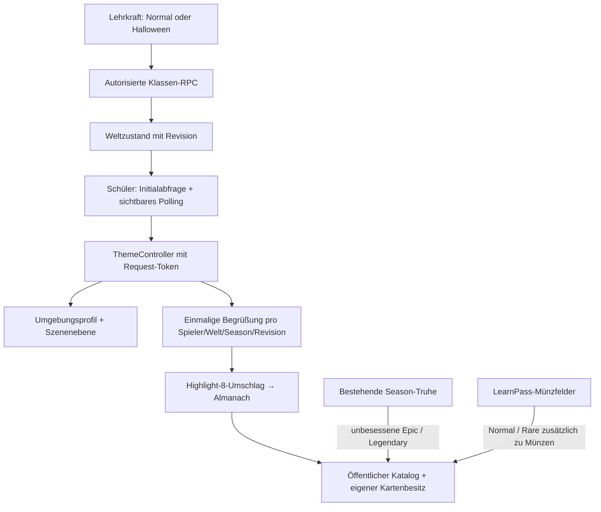

# Lerndorf Halloween-Season & Collection · DeepSeek Implementation Plan

> **For agentic workers:** REQUIRED SUB-SKILL: Use superpowers:subagent-driven-development (recommended) or superpowers:executing-plans to implement this plan task-by-task. Steps use checkbox (`- [ ]`) syntax for tracking.
>
> **An DeepSeek:** Wenn diese Skills in deiner Umgebung nicht vorhanden sind, führe dieselben Pakete einzeln mit den beschriebenen Prüfungen aus. Keine Abhängigkeit von bestimmten Agentenwerkzeugen schaffen. Dieser Auftrag erstellt den Plan; die nachfolgenden Produktionsänderungen sind noch nicht ausgeführt.

**Goal:** Den freigegebenen Halloween-Prototyp in das bestehende Lerndorf übernehmen: pro Klassenwelt umschaltbare Atmosphäre, Begrüßung, Highlight-8-Almanach und 50 Sammelkarten; die bereits vorhandenen Season-/LearnPass-/Truhenfunktionen erhalten und gezielt ergänzen.

**Architecture:** Eine serverseitige Klassenkonfiguration steuert eine austauschbare Szenenebene und ein Umgebungsprofil. Die Collection wird eine eigenständige App-Ansicht mit getrennten öffentlichen Kartendefinitionen und serverseitigem Besitz. Vorhandener LearnPass, Dorfgegenstände und deren Truhenökonomie bleiben ein eigener Bereich.

**Tech Stack:** TypeScript strict, Vite, Vanilla DOM/CSS, Three.js **0.170.0**, Supabase/PostgreSQL mit RLS und Security-Definer-RPCs, Vitest/PGlite, Playwright. Vorhandene Bibliotheken verwenden, kein neues UI-Framework.

**Stand:** 27.10.2026. Zielgruppe: DeepSeek als Implementierer; fachliche/gestalterische Abnahme durch Thomas bzw. die von ihm beauftragte Reviewinstanz. Maßgeblich sind die aktuelle Codebasis und die hier festgehaltenen jüngsten Nutzerentscheidungen.

**Verbindliche Ergänzung r11 — Vergabe ohne Kartenduplikate:** Die 18 Normal- und 17 Rare-Karten werden schrittweise über den LearnPass vergeben, **zusätzlich zu Münzen auf denselben Feldern**. Die 14 Epic-Karten und die einzige Legendary (`highlight-halloween-card`) kommen ausschließlich aus Seasonal Boxes. Jede Karte kann pro Spieler höchstens einmal besessen/vergeben werden. Verbindliches Zuordnungsmanifest: `assets/collection/card-acquisition.json`; keine Produktionsvergabe ist im Prototyp implementiert.

**Verbindliche Ergänzung r13 — Spooky-Einstieg und Starterkurs:** Maßgeblich für Stand/Ticket/Welcome/Quiz ist `DEEPSEEK_SPOOKY_STARTER.md`. Der Stand mit der vom Nutzer gelieferten Halloween-Katze ist bereits gebaut (`assets/season-starter/spooky-stand.glb`, Quelle `.blend`, Vorschau `stand.html`); **kein Modellbauauftrag für DeepSeek mehr**. Stand und Ticket sind im normalen Dorf erreichbar, unabhängig von dunkler Halloween-Weltoptik. Zehn reine Tablet-Klickfragen (Odd one out, Steigerung, BE/AE, vier Edge-TTS-Hörfragen mit deutschen Bedeutungsbuttons) vergeben einmal pro Season 150 XP ohne Stempel. Automatisches Season-Welcome hängt am laufenden Event, nicht ausschließlich am effektiven Halloween-Theme. Produktionsintegration und Quiz-XP sind noch auszuführen.

**Korrektur r14 hat Vorrang:** Aktives fertiges Shop-Ensemble ist `assets/season-starter/halloween-shop-event.glb` (gelieferter Shop, nur große Katze, Candy Cauldron davor). Eigener Stand auf Ersatzbank in `assets/season-starter/bench/custom-stand-r1/`. Welcome nur Quiz/150 XP/LearnPass; keine Sammelkartenerklärung. Zusätzliche große 3D-Gegenstandsvorschau für „What’s in it?“ nach `DEEPSEEK_WHATS_INSIDE_3D.md`. Aktuelle Details: `DEEPSEEK_SPOOKY_STARTER.md` und `STAND_INTEGRATION.md`.

---

## 0. Verbindliche Grenzen

- Keine Commits, Pushes, Deployments oder Ausführung von Migrationen gegen ein Live-Projekt ohne gesonderten Nutzerauftrag.
- Bereits angewendete Migrationen nicht nachträglich ändern. Schema-/RPC-Erweiterungen ausschließlich als neue Migrationen ergänzen; aktuelle freie Nummern und vorhandenen Migrations-Lock vor Beginn prüfen.
- `Prototyp/index.html` bleibt das unveränderte Soll-Bild. `Prototyp/marktplatz/` als Liefer-/Reviewquelle erhalten; keine Quellen löschen oder komplette Prototypskripte in die App kopieren.
- Dieser Plan liegt absichtlich im erlaubten Prototyp-Unterordner. Die hier genannten Änderungen unter `web/` und `supabase/` sind **geplante Integrationsarbeit**, keine in diesem Planungsschritt vorgenommenen Änderungen.
- Vor Beginn `CLAUDE.md`, `docs/SCOPE.md`, `docs/SPEC.md`, `docs/LOOK.md`, `docs/PLAN.md` und `docs/PLAYER_LANGUAGES.md` lesen. Nutzerentscheidungen dieses Gesprächs gehen älteren Planannahmen vor.
- Keine echten Schülerdaten, Tracker oder Analytics. Synthetische Testkonten verwenden. Der Titel „Kerim ab in die Kühlbox“ ist ein gelieferter Spruch, kein Personen-/Disziplinardatensatz.
- Spieler-UI standardmäßig Englisch, über vorhandene i18n auf Deutsch umschaltbar; Lehrer-UI Deutsch. Vorgegebene Kartentitel, Gedichte und Lerninhalte nicht automatisch übersetzen oder korrigieren.
- Münzen, Besitz, Vergabe und Platzierungen ändern sich ausschließlich über autorisierte serverseitige RPCs. Keine direkten Client-Schreibrechte auf Tabellen; keine Service-Keys im Browser.
- 8a und 8b sind getrennte Welten. Schüler-RPCs ermitteln `current_class()` selbst. Lehrer-RPCs dürfen eine Klasse als Parameter annehmen und prüfen die Lehrerrolle.
- Platzierung deterministisch mit vorhandenem `createRng`; kein `Math.random` in Welt-/Dekorationsplatzierung. Serverseitige Truhenauslosung ist ein anderer Anwendungsfall.
- Ziel: mindestens 30 FPS auf dem ältesten Schul-Tablet. Für die übernommene Halloween-Szene gelten <150.000 Dreiecke und <150 Draw Calls als Zielbudget; das gesamte Dorf zusätzlich messen. Desktop-FPS nicht als Tablet-Nachweis ausgeben.
- Bei „Weniger Bewegung“ keine automatische Umkreisung im Almanach, keine Flacker-/Zombie-/Fontänenbewegung; manuelles Drehen/Zoomen bleibt nutzbar.
- Keine neuen Modelle/Bilder erzeugen: die benötigten Assets sind vorhanden. Lizenz-/Herkunftsnachweise mitnehmen. Buchbilder und Ableitungen nicht pauschal als CC0 deklarieren.

## 1. Zuerst den tatsächlichen Stand verstehen

### 1.1 Bereits vorhandene Produktionsmodule — wiederverwenden

| Vorhandener Pfad | Gelesener Vertrag / Bedeutung |
| --- | --- |
| `web/src/api/season.ts` | `seasonApi()`, `SeasonState`, `SeasonApi`; State, Pass, Truhen, Shop, Auswahl und Verkauf |
| `web/src/teacher/pages/season.ts` | Lehrer-Seite mit Start/Ende/Abschluss, Datumspflege und Klassenübersicht |
| `web/src/teacher/pages/village.ts` | Klassenweise Schalter für Shop/Bauen, Karten-/Seed-/Regelpflege |
| `web/src/teacher/context.ts` | `TeacherContext.classId`, `alive()`, `status()`, `refresh()` |
| `web/src/ui/seasonChests.ts` | Vorhandenes Truhenöffnen und „Was ist drin?“ im Inventar |
| `web/src/ui/seasonCard.ts`, `seasonShop.ts`, `ui/learnpass/` | LearnPass- und Truhen-Darstellung; nicht mit den neuen Sammelkarten verwechseln |
| `web/src/ui/villageView.ts` | `mountVillage`, `stop()`, `openSeasonPass`, Tutorial, Modal-/Area-Lebenszyklus und zentrale Animation |
| `web/src/api/village.ts` | `ClassSettings`, `loadClass`, Profil-/Klassenkontext; enthält bisher keinen Welt-Themenschalter |
| `web/src/render/scene.ts` | `setupScene`, `SceneRig.sun`, `follow()`, asynchrones `skyReady` |
| `web/src/render/village.ts` | `buildVillage`, `userData.animate`, `userData.setSky`, normaler Platz und Grundstücke |
| `web/src/render/plaza.ts` | Normaler Brunnen, Aufgabenbrett, Stände und Bänke |
| `web/src/render/merge.ts` | `bakeStatic()` verschmilzt statische Geometrie; wichtig für austauschbare Platzteile |
| `web/src/render/glbItems.ts` | Gecachte normalisierte Vorlagen, `loadGlbItem()` liefert Klone; Geometrie/Material können geteilt sein |
| `web/src/world/plotPlan.ts`, `layout.ts`, `geometry.ts` | Reale Grundstücksgrenzen, Slots und Geländehöhen |
| `web/src/ui/dialog.ts`, `areas.ts` | `openModal`, Fokus/`inert`, ModalTracker, AreaHandle und Übergänge |
| `web/src/ui/gameNav.ts` | Bisher zwei Hauptbuttons Aufgaben/Haus; Collection nicht als ungeplanten dritten Hauptbutton einführen |
| `web/src/i18n.ts`, `web/src/i18n/` | Vorhandene Übersetzungs-/Locale-Infrastruktur |
| `supabase/migrations/0028_seasons.sql` bis `0033_season_rewards.sql` | Bestehende Seasons, Pass, Truhen, Inventar-/Belohnungs- und Lehrerfunktionen |
| `web/tests/teacherDb.ts`, `web/tests/sql/seasonClock.ts` | PGlite-Auth-/Klassenfixtures und kontrollierte Season-Zeit |
| `docs/superpowers/plans/2026-10-27-season-und-learnpass.md` | Frühere bestätigte LearnPass-/Dorfgegenstandsregeln |
| `docs/superpowers/reviews/2026-10-27-claude-review-season.md` | Historische Reviewbefunde; gegen aktuellen Code prüfen, nicht blind erneut „reparieren“ |

**Wichtige Aktualisierung gegenüber älteren Prototyp-Notizen:** In der App existieren inzwischen echte Seasons, Truhen und Lehrerfunktionen. Es fehlt deren Verbindung mit der neuen Atmosphäre und Karten-Collection; es fehlt nicht das ganze Season-System.

### 1.2 Drei Domänen unbedingt trennen

1. **Weltoptik pro Klasse:** Normal/Halloween, Deko, Licht, Nebel, öffentliche Grundstücksränder.
2. **Bestehender LearnPass und Dorfgegenstände:** globale Season-Daten, XP, 28 Truhengegenstände, Münzen, bestehendes Inventar.
3. **Neue Karten-Collection:** 50 Kartendefinitionen, eigener Kartenbesitz und Almanach.

`teacher_start_season_now` / `teacher_end_season_now` ändern den globalen Season-Zeitraum und können XP-/Belohnungsvorgänge auslösen. **Diese RPCs dürfen nicht als klassenweiser Optik-Schalter missbraucht werden.**

Die vorhandenen Truhen verwenden bei Dorfgegenständen `common/rare/epic/legendary`. Die Karten verwenden `normal/rare/epic/legendary`. Die Nutzerentscheidung **„nur Highlight 8 ist Legendary“ gilt für Karten**; Horror-Haus und Warlock nicht im Dorfgegenstands-Pool herabstufen. Die bestehenden 55/30/12/3-Prozent-Regeln nicht durch Einfügen von Karten in `items` verändern.

## 2. Verbindlicher Inhaltsvertrag

### 2.1 Lieferstand

- **50 aktive Karten:** 18 Normal, 17 Rare, 14 Epic, genau eine Legendary.
- Exklusive Legendary-ID: **`highlight-halloween-card`**.
- 30 Reliefkarten mit eigenständigen Motiven; 20 flache Druckkarten (12 Buch-/Covermotive, 8 Classroom Curses).
- Acht alte Figurenvarianten bleiben `archivedCards` / `status: benched`; weder importieren noch verlosen.
- Highlight-8-Grafik hat zwei Rollen: gemeinsamer Umschlag des Seasonal Almanac und separat besitzbare Legendary-Karte.
- `almanacCover.requiresCardOwnership` ist `false`: der Almanach öffnet auch ohne Besitz der Legendary-Karte. Anzeigen des Umschlags ist keine Vergabe.
- `book.html` liefert das dickere Buchmodell; die dünne Legendary-Karte ist ein anderes GLB mit denselben Vorder-/Rückseitenbildern. Keine physische Aufklappanimation erforderlich; Cover → Almanachansicht genügt für v1.
- Achievements bleibt ein klarer Platzhalter. Rahmen-/Titelstudien sind keine neuen automatisch vergebenen Erfolge.
- Sechs klassische Verse samt Autor/Werk/Quelle erhalten; das Vogelgedicht aus der gelieferten Buchseite hat keine erfundene Autorzuschreibung.
- Neun Original-Lernausschnitte werden unverändert eingebettet; Halloween-Beispiele sind zusätzliche Inhalte. Vorhandene Aussparungen nicht nachträglich als Aufgabenlösungen ausfüllen.
- Classroom Curses: deutsche Nutzerzitate als Titel; englische Beschreibung, `effects[]` und `flavour`. `effectMode: flavour-only` und `satire: true` bedeuten reine Darstellung. Kein Effekt-Interpreter, keine Sanktionen, keine Hausaufgaben-/Verweis-Datensätze, kein Klassenentfernen.

### 2.2 Maßgebliche Lieferdateien

`Prototyp/marktplatz/assets/collection/catalog.json` ist die öffentliche Inhaltsquelle. `prints/manifest.json` beschreibt alle 20 Druck-GLBs. Vollständige Herkunft: `assets/collection/LICENSES.md`, `LITERARY_SOURCES.md`, `prints/curses/generation-manifest.json`. `CLAUDE_HANDOFF.md` beschreibt den Prototyp; dieser Plan ergänzt die konkrete App-Integration anhand der aktuellen Codebasis.

Die Drucknummern 1–30 und 39–58 sind keine lückenlose Eigentums-/Indexfolge. IDs und Nummern erhalten. Nicht anhand der Nummer auf Seltenheit oder Besitz schließen.

## 3. Zielarchitektur und neue Verträge

### 3.1 Geplante Dateistruktur

Alle folgenden neuen Pfade sind **Vorschläge für neue Implementierungsdateien**, keine Behauptung vorhandenen Codes. Vor Ausführung auf Namenskollisionen prüfen. Aktuell letzte gelesene Migration: 0033; falls inzwischen weitere existieren, ausschließlich neue freie Nummern vergeben und diesen Plan entsprechend nachführen.

| Geplanter Pfad | Verantwortung |
| --- | --- |
| `web/scripts/import-halloween-prototype.ts` | Validieren und ausschließlich benötigte Laufzeitassets kopieren; kein Bild-/Modellbau |
| `web/public/assets/halloween-market/` | Genutzte Platz-/Dekoassets und Laufzeitmanifest |
| `web/public/assets/collection/` | Abgeleiteter Laufzeitkatalog und aktive Karten/Buch/Thumbnails/Druckquellen |
| `web/src/collection/types.ts` | Öffentliche Inhalts- und Besitztypen |
| `web/src/collection/catalog.ts` | Laden, Validieren, Assetpfade; keine Benutzerzustände |
| `web/src/collection/cardPreview.ts` | Begrenzter GLB-Cache, Kamera, Flip, Resize, Render-/Disposal-Lebenszyklus |
| `web/src/collection/collectionView.ts` + `.css` | Cover, Cards-Almanach, Suche/Filter, Achievements-Platzhalter |
| `web/src/api/worldTheme.ts` | Weltzustand, Lehrer-Umschaltung und Welcome-Ack als RPC-Adapter |
| `web/src/api/collection.ts` | Eigenen Kartenbesitz laden; keine Client-Vergabe |
| `web/src/season/worldThemeController.ts` | Polling, Versionsschutz, Anwendung, Welcome-Bedarf |
| `web/src/season/seasonWelcome.ts` + `.css` | Zugänglicher Season-Dialog und wahrheitsgemäße Boxen-Erklärung |
| `web/src/render/season/environment.ts` | Reversible Normal-/Halloween-Umgebungsprofile |
| `web/src/render/season/halloweenLayer.ts` | Deko, Lampions, Mond/Nebel, maximal fünf Figuren |
| `web/src/render/season/halloweenFountain.ts` | Port des bewegten Brunnens; keine eigene Renderloop |
| `web/src/render/season/plotBorderDecor.ts` | Deterministische öffentliche Rand-Deko anhand echter Plot-Geometrie |
| `supabase/migrations/0034_class_world_theme.sql` | Klassenoptik, Welcome-Acks, RLS und Rollen-RPCs |
| `supabase/migrations/0035_collection_cards.sql` | Kartenkatalog, Besitz, serverinterne Vergabebelege, Read-RPC |
| `supabase/migrations/0036_collection_chest_rewards.sql` | Feste Passkarten plus atomare duplikatfreie Epic-/Legendary-Truhenvergabe |
| `web/dev/season-world.html`, `web/dev/collection.html` | Lokale synthetische Abnahme-/E2E-Harnesses ohne echte Konten |

Bestehende Dateien gezielt erweitern: `render/scene.ts`, `render/plaza.ts`, `render/merge.ts`, `render/village.ts`, `ui/villageView.ts`, `ui/accountMenu.ts`, `teacher/pages/village.ts`, `teacher/api.ts`, i18n und Tests. `api/season.ts`, LearnPass-UI und `ui/seasonChests.ts` im Vergabepaket 9 gezielt erweitern.

### 3.2 Gemeinsame TypeScript-Verträge

Diese Signaturen im ersten betroffenen Paket anlegen und in Folgepaketen identisch verwenden:

```ts
// collection/types.ts
export type CardRarity = 'normal' | 'rare' | 'epic' | 'legendary';
export type CardKind = 'grammar' | 'vocabulary' | 'proverb' | 'rhyme'
  | 'simile' | 'tongue-twister' | 'poem' | 'humour';
export interface CardDefinition {
  id: string; number: number; name: string; rarity: CardRarity;
  kind: CardKind; format?: 'printed-surface'; series?: string;
  model: string; motifModel: string; thumbnail: string;
  front: string; back: string; topic: string; key: string;
  example: string; notes: string[]; tip: string;
  description?: string; effects?: string[]; flavour?: string;
  satire?: boolean; effectMode?: 'flavour-only';
  source?: {
    type: 'original-excerpt'; author: string; work: string;
    location: string; url: string; publisher: string;
    excerptLines: string[]; verifiedOn: string; rights: string;
    authorNote?: string; additionalUrl?: string;
  };
  reference?: {
    type: 'user-supplied-textbook-adaptation'; work: string;
    publisher: string; page: string; note: string;
    sourceImage?: string; author?: string;
  };
}
export interface CardOwnership {
  cardId: string; quantity: 1; firstAcquiredAt: string;
}
export interface CollectionState {
  seasonId: string; cards: CardOwnership[];
}
export interface CollectionCatalog {
  cards: CardDefinition[];
  rarityOrder: CardRarity[];
  almanacCover: {
    cardId: 'highlight-halloween-card'; front: string; back: string;
    bookModel: string; requiresCardOwnership: false;
  };
  rarityPolicy: { legendaryExclusiveCardId: 'highlight-halloween-card' };
}

// api/worldTheme.ts
export type WorldTheme = 'normal' | 'halloween';
export interface WorldThemeState {
  classId: string; requestedTheme: WorldTheme; effectiveTheme: WorldTheme;
  revision: number; seasonId: string | null;
  seasonLabel: string | null; seasonState: string | null;
  welcomeSeen: boolean;
}
export interface WorldThemeApi {
  state(): Promise<WorldThemeState>; // Schülerklasse aus auth, kein classId-Argument
  acknowledgeWelcome(seasonId: string, revision: number): Promise<void>;
  teacherState(classId: string): Promise<WorldThemeState>;
  teacherSet(classId: string, theme: WorldTheme, seasonId: string | null): Promise<void>;
}

// render/season/halloweenLayer.ts
export interface SeasonLayer {
  group: THREE.Group;
  update(dt: number, elapsed: number, reducedMotion: boolean): void;
  dispose(): void; // nur Ressourcen im eigenen Besitz
}

// season/worldThemeController.ts
export interface WorldThemeController {
  refresh(): Promise<void>;
  update(dt: number, elapsed: number, reducedMotion: boolean): void;
  dispose(): void;
}

// collection/cardPreview.ts
export interface CardPreview {
  show(card: CardDefinition, mode: 'card' | 'motif'): Promise<void>;
  flip(): void;
  resetView(): void;
  setActive(active: boolean): void;
  dispose(): void;
}
```

`THREE` wird im Render-Modul als Namespace aus dem bestehenden `three` importiert. Farb-/Metadatenfelder aus dem Katalog dürfen ergänzt werden; keine unbekannten JSON-Felder als ausführbaren Code behandeln.

### 3.3 Ablauf



## 4. Paket 1 — Bestandsaufnahme, Baseline und Runtime-Import

**Dateien:** neue Import-/Katalogdateien aus §3; Test `web/tests/collection/catalog.test.ts`; bestehende Projektanweisungen nur lesen.

**Eingang:** Prototyp-Katalog und tatsächlicher Git-/Migrationsstand. **Ausgang:** validierter Runtime-Katalog mit genau 50 aktiven IDs, reproduzierbares Kopiermanifest und unverändertem Prototyp.

- [ ] `git status --short` lesen; vorhandene fremde Änderungen dokumentieren. Keine Resets, keine pauschale Bereinigung.
- [ ] Schutz-Hashes aus `Prototyp/marktplatz/tools/protected-baseline.json` für `Prototyp/index.html` und `docs/LOOK.md` vergleichen. Ausgangszustand der normalen App vor Integration festhalten.
- [ ] Tests für Kartenzahl, eindeutige IDs/Nummern, aktive/archivierte Trennung, Seltenheiten und verbotene Assetpfade schreiben. Negativfälle: zweites Legendary, doppelte ID, `../`-Pfad, unbekanntes Kartenformat, satirischer Effekt mit anderem `effectMode`.
- [ ] Importskript anlegen. Aus `catalog.cards` die Vereinigung von `model`, `motifModel`, `thumbnail`, `front`, `back` bilden; `almanacCover` und benötigtes Buch ergänzen. Pfade deduplizieren. Nicht den ganzen Assets-Ordner ungeprüft kopieren.
- [ ] Laufzeitassets unter den Zielpfaden kopieren. Keine `.blend`, Generatorlogs, ungenutzten Figuren, alten Ensemblebilder oder vollständigen Prompt-/Quellenarchive als vorzuladende Spielassets ausliefern. Herkunft bleibt im Repository; benötigte Lizenz-/Creditsdateien mitführen.
- [ ] GLBs enthalten Texturen bereits. Die Front-/Back-Quellen sind nur für „Druckbild ansehen“ nötig und werden bedarfsgesteuert geöffnet, nicht vorab geladen.
- [ ] Große ursprüngliche Bilddateien nicht nochmals erzeugen. Vorhandene GLBs/Thumbnails auslieferungsfähig übernehmen; KTX2-/Meshopt-Neukompression nur nach gesondert nachgewiesenem Bedarf und erneuter Qualitätsprüfung.
- [ ] `import.meta.env.BASE_URL` in genau einer Assetbasis berücksichtigen; keine `127.0.0.1`, Laufwerksbuchstaben oder `/Prototyp/`-URLs in der App.

**Prüfung:** `cd web; npm run test -- tests/collection/catalog.test.ts`; Test erwartet 18/17/14/1 und exakt `highlight-halloween-card` als Legendary. Import zweimal ausführen; Dateiliste/Inhalts-Hashes müssen gleich bleiben. Fehlende Datei muss den Import mit konkretem Dateipfad abbrechen.

**Abnahme:** Nur aktive Lieferassets sind erreichbar, keine 3D-Ladevorgänge beim bloßen Katalogabruf. Keine zusätzliche Karten-Kopie im Gegenstands-`items`-Pool.

## 5. Paket 2 — Klassenweiser Weltzustand und Welcome-Ack

**Dateien:** neue Migration `0034_class_world_theme.sql`; `web/src/api/worldTheme.ts`; Tests `web/tests/sql/world-theme.test.ts`, `web/tests/api/worldTheme.test.ts`.

**Eingang:** bestehende `classes`, `profiles`, `seasons`, `is_teacher()`, `current_class()`, `season_today()`, `season_state_of()`. **Ausgang:** `WorldThemeApi` aus §3.2.

### Datenmodell

```sql
create table public.class_world_theme (
  class_id text primary key references public.classes(id) on delete cascade,
  theme text not null default 'normal' check (theme in ('normal','halloween')),
  season_id text references public.seasons(id),
  revision integer not null default 0 check (revision >= 0),
  changed_at timestamptz not null default now(),
  changed_by uuid references public.profiles(id),
  check ((theme = 'normal' and season_id is null)
      or (theme = 'halloween' and season_id is not null))
);

create table public.season_welcome_seen (
  player_id uuid not null references public.profiles(id) on delete cascade,
  class_id text not null references public.classes(id) on delete cascade,
  season_id text not null references public.seasons(id),
  revision integer not null check (revision >= 0),
  seen_at timestamptz not null default now(),
  primary key (player_id,class_id,season_id,revision)
);
```

Neue Klassen ohne Konfigurationszeile werden beim Lesen als Normal behandelt; keine Schreibrechte beim Schüler-Read benötigen. Bestehende Klassen optional per Migration mit Normal auffüllen.

### RPC-Verträge

- `world_theme_state()` → aktuellen Schüler aus `auth.uid()` / `current_class()` ableiten; `WorldThemeState` als JSON mit den vereinbarten camelCase-Feldern liefern.
- `teacher_world_theme_state(p_class text)` → nur Lehrkraft, existierende Klasse prüfen.
- `teacher_set_world_theme(p_class text,p_theme text,p_season text)` → nur Lehrkraft; Zeile sperren, bei tatsächlicher Konfigurationsänderung Revision erhöhen, `changed_by` setzen. Wiederholung identischen Zustands verändert die Revision nicht.
- `ack_season_welcome(p_season text,p_revision integer)` → eigene Klasse/UID aus Auth; nur aktuellen effektiven Halloween-Zustand quittieren; Tupel idempotent einfügen. Ein alter Revisionseintrag darf keine neu aktivierte Season quittieren.

**Festgelegte Trennung:** Die Konfiguration wählt nur die Optik. Effektives Halloween gilt bei passender konfigurierter Halloween-Season und laufendem Kalenderfenster; sonst Normal. `teacher_set_world_theme` darf eine passende geplante Season vormerken, ändert aber keine Dates/XP. Das Lehrer-UI zeigt „vorgemerkt“ außerhalb des laufenden Fensters und erklärt die tatsächliche Wirkung. Das bestehende `season_state_of`/`season_today` verwenden; keine zweite Zeitzonenberechnung im Browser. Wenn Thomas ausdrücklich ein klassenweites Vorab-Halloween unabhängig vom Kalender wünscht, diese eine Regel vor dem Rollout separat entscheiden, nicht über „Jetzt starten“ umgehen.

- [ ] Zuerst SQL-Tests für Schülerverweigerung, anonyme Verweigerung, fremde Klasse, identisches Save, Revisionswechsel, Ende/Abschluss und getrennte Klassen schreiben.
- [ ] Tabellen mit RLS aktivieren, alle Standard-Schreibrechte `public/anon/authenticated` widerrufen. SELECT nur im benötigten Umfang; Schüler sehen eigene Klasse/eigene Acks, Lehrkraft die Klassenkonfigurationen.
- [ ] RPCs mit `security definer set search_path = public` erstellen; interne Hilfsfunktionen nicht pauschal ausführbar machen. Lehrerrolle und Saison-/Klassenzugehörigkeit serverseitig prüfen.
- [ ] SQL-Fehler in deutscher Lehrer-UI in verständliche Meldungen übersetzen; keine Roh-SQL-Fehler anzeigen.
- [ ] Dünnen API-Adapter implementieren. Keine frei übergebenen Spieler-IDs in Schüler-RPCs.

**Prüfung:** PGlite mit 8a/8b, je mindestens zwei synthetischen Spielern und einer Lehrkraft. 8a aktivieren verändert weder 8b noch `seasons`, `season_claims`, `season_chests`, `coins` oder Platzierungen. Zwei gleichzeitige Lehrersaves bleiben konsistent. Ack für alten Zustand → abgewiesen; gleicher Ack zweimal → ein Datensatz. Nicht angemeldeter Zugriff → 42501.

## 6. Paket 3 — Lehrerbedienung und Synchronisierung

**Dateien:** `web/src/teacher/pages/village.ts`, `web/src/teacher/api.ts`, `web/src/season/worldThemeController.ts`; Tests `web/tests/teacher/worldThemePage.test.ts`, `web/tests/season/worldThemeController.test.ts`.

**Eingang:** API aus Paket 2, `ctx.classId` und `ctx.alive()`. **Ausgang:** gespeicherte Klassenoptik und ein abbrechbarer Zustandscontroller.

- [ ] Auf „Dorf & Regeln“ eine eigene Sektion **Weltstimmung** mit Normal / Season I – Halloween ergänzen. Bestehende Shop-/Bauschalter und Seedformulare nicht umdeuten.
- [ ] Beim Klassenwechsel Formular neu laden; verspätete Antworten nur anwenden, wenn `ctx.alive()` und Klassen-ID noch stimmen. Save bis Abschluss sperren und Erfolg/Fehler anzeigen.
- [ ] Angeforderte und effektive Optik anzeigen. Hinweis: „Ändert nur die Dorfstimmung dieser Klasse. LearnPass und Saisonzeitraum werden hier nicht verändert.“
- [ ] Controller fragt initial ab, danach alle **30 Sekunden nur im sichtbaren Tab**. Bei `visibilitychange` zurück zu sichtbar sofort aktualisieren. Bei Fehler aktuelle gültige Szene behalten, erneuter Versuch beim nächsten Intervall; keine parallelen Polls aufstauen.
- [ ] Zustandsvergleich aus `(classId, requestedTheme, effectiveTheme, seasonId, revision)` bilden. Kalenderende kann effektives Theme ohne neue Klassenrevision ändern und muss trotzdem reagieren.
- [ ] Pro Apply einen Request-Token erhöhen. Wenn `Normal → Halloween → Normal` während GLB-Laden geschieht, darf das verspätete Halloween-Ergebnis nicht mehr eingehängt werden; eigene temporäre Ressourcen freigeben.
- [ ] `dispose()` bricht Polling, Events und ausstehende Zustandsverarbeitung ab. Bei Logout/Klassenwechsel keine alte Weltantwort anwenden.

**Prüfung:** Fake-Timer: höchstens eine laufende Anfrage; versteckter Tab pollt nicht; Rückkehr fragt sofort; beide 8a-Clients gleichen sich spätestens nach einem sichtbaren Intervall ab; 8b bleibt Normal. Schüler sehen keinen Lehrerschalter. API-Fehler löst keine falsche Erfolgsmeldung aus.

## 7. Paket 4 — Reversible Umgebung und austauschbarer Marktplatz

**Dateien:** `render/scene.ts`, `render/plaza.ts`, `render/merge.ts`, `render/village.ts`; neue Module unter `render/season/`; Tests `web/tests/render/seasonEnvironment.test.ts`, `halloweenLayer.test.ts`, `plazaSeason.test.ts`.

**Eingang:** `Layout`, `SceneRig`, Renderer, vorhandene normale Szene, Themezustand. **Ausgang:** eine `SeasonLayer`, reversible Umgebungsprofile und austauschbare Deko ohne Grundstücksverlust.

### Konkrete Fallen des vorhandenen Rendercodes

1. `setupScene()` lädt die normale Himmelstextur asynchron und schreibt danach direkt `scene.background`. Das darf ein inzwischen aktives Halloween nicht überschreiben.
2. `SceneRig.follow()` setzt Sonnenposition und Target in jedem Frame. Ein anderer Lichtstand muss über das gewählte Profil einfließen, sonst wird er im nächsten Frame zurückgesetzt.
3. `buildVillage()` gibt `bakeStatic(root)` zurück. Bereits zusammengebackene Brunnen-/Standgeometrie verschwindet nicht, wenn später nur eine leere Ursprungsgruppe versteckt wird.
4. `loadGlbItem()` klont Objekte, kann aber Geometrien/Materialien aus einem gemeinsamen Cache teilen. Ein pauschales `traverse(...dispose())` auf der Season-Gruppe könnte Inventar-/Dorfmodelle beschädigen.

- [ ] Normalprofil aus dem bestehenden LOOK-Stand vollständig erfassen: Hintergrund/Textur/Intensität, Fog-Typ/Farbe/Near/Far, Hemisphere-/Sun-/Fillwerte, Schattenparameter und Renderer-Exposure. Keine Werte über viele Dateien verteilt raten.
- [ ] `SceneRig` um Profilwahl erweitern; normale Skytexture nach Laden cachen und nur bei aktivem Normalprofil anwenden. Wechsel auf Normal nach abgeschlossenem oder spätem Laden muss identische ursprüngliche Werte herstellen.
- [ ] Sonnen-Offset in `follow()` profilabhängig halten; keine zwei konkurrierenden Licht-/Himmelsschreiber.
- [ ] Normale austauschbare Platzteile in klaren Gruppen halten. Aufgabenbrett, Sir Byte, Zugänge und Questinteraktion sind geschützte Kernobjekte und bleiben zugänglich.
- [ ] Beim Baking eine explizite nicht-bakebare Gruppe unterstützen: `isBakeable(mesh)` prüft auch Vorfahren, z. B. `userData.bakeStatic === false`. Nur ein Flag auf der Gruppe reicht beim bisherigen Code nicht. Bestehende `userData.kind`-Klickrollen erhalten.
- [ ] Den Nicht-Bake-Marker nur auf die tatsächlich austauschbaren Untergruppen setzen, nicht auf den ganzen Dorfroot. Sonst steigt die Zahl der Draw Calls unnötig für die gesamte Welt.
- [ ] Halloween relativ zu `layout.plaza` und realem `plazaHeight` aufbauen. Aus dem Prototyp **Deko/Fountain/Atmosphäre** portieren, nicht `buildWorld` als zweite komplette Welt mit eigenem Boden/Grundstücken übernehmen.
- [ ] Den alten Brunnen samt Tropfen/Animation genau einmal ausblenden, wenn der Halloween-Brunnen aktiv ist. Normale Brunnenanimation unter Halloween nicht unsichtbar weiterrechnen. Rückwechsel reaktiviert sie ohne neue Kopie.
- [ ] Blutmond/Halo, Nebel, Lampions, Kürbisse, Gräber, tote Bäume und die fünf Figuren nach dem freigegebenen Prototyp ergänzen. Den **bereits gebauten** Spooky-Stand mit Katzenmaskottchen importieren, nicht neu modellieren; seinen Einstieg unabhängig vom Halloween-Overlay halten (r13-Zusatzplan). Material-/Instanzbündelung behalten; Anzahl der echten Punktlichter begrenzen.
- [ ] `fountain.js` nach TypeScript portieren: gebogene **Vertexbewegung**, Reflexe/Spritzer/Wellen und senkrechter kurz–kurz–lang-Puls bleiben erhalten. Alle Updates über `WorldThemeController.update()` in der vorhandenen Dorfloop ausführen.
- [ ] Geteilte Assets von eigenen Geometrien/Materialien/Texturen unterscheiden. Eigene Halo-/Nebel-/Wasser-/Flammentexturen freigeben; geteilte Cachevorlagen nicht zerstören. Dazu eine kleine Besitzliste oder ein Release-Handle pro Loader nutzen.
- [ ] Bei Low Quality Schatten/Lichter/Nebelpartikel nach vorhandenem Qualitätsprofil reduzieren. Moduswechsel und reduzierte Bewegung bereits beim Erzeugen berücksichtigen.

**Prüfung:** Normal-Snapshot → Halloween → Normal zehnmal. Werte, Anzahl aktiver Lampen/Figuren, Objekte und Animationen bleiben stabil. Mit verzögertem `skyReady` und verzögertem GLB prüfen. Ein zuvor platziertes identisches Season-Modell bleibt nach Overlay-Disposal sichtbar. Fontänen-Vertexkoordinaten verändern sich bei normaler Bewegung und bleiben bei reduzierter Bewegung unverändert. Keine zweite RAF-/Rendererloop erzeugen.

## 8. Paket 5 — Öffentliche Grundstücksränder dekorieren

**Dateien:** `render/season/plotBorderDecor.ts`; bestehende `world/plotPlan.ts`, `world/geometry.ts`, `world/layout.ts` als Eingaben; Test `web/tests/world/seasonBorderDecor.test.ts`.

**Eingang:** reale Plots, Wege, Terrain und Layoutseed. **Ausgang:** deterministische Deko-Anker außerhalb der Bauflächen.

- [ ] Reine Funktion planen: `planSeasonBorderDecor(layout: Layout): DecorAnchor[]`, mit `DecorAnchor = { kind: 'pumpkin' | 'lantern'; x: number; z: number; yaw: number }`.
- [ ] Für jeden Plot Kandidaten nur auf der öffentlichen Seite der Grundstücksgrenze erzeugen. Objekt-Footprint und Sicherheitsabstand einbeziehen, nicht nur den Mittelpunkt prüfen.
- [ ] Kandidaten ablehnen, wenn sie Baufläche, Eingang/Tor, Fußweg, Zufahrt, Fluss oder gesperrten Geländebereich schneiden. Bestehende Geometriehilfen verwenden; keine fest codierten Beispielplot-Koordinaten aus dem Prototyp.
- [ ] Seed mit konstantem Season-Salt kombinieren. Beispiel: eigener `createRng` mit Layoutseed und dokumentiertem Halloween-Salt; dieselbe Klasse erzeugt dieselben Anker.
- [ ] Dekor auf echte Bodenhöhe setzen und instanzieren. Anzahl pro Plot begrenzen; keine Lampen pro Dekoobjekt als Punktlicht erzeugen.

**Prüfung:** Alle vorhandenen Kartenvorlagen/Seeds und alle 34 Plots testen. Gleiche Eingaben → gleiche Anker; keine Bau-/Zufahrts-/Flussüberschneidung inklusive Dekoausdehnung. Leere und bebaute Grundstücke bekommen dieselbe öffentliche Deko, ohne Haus-/Slotdaten zu ändern. Zwei unterschiedliche Seeds liefern zulässige, nicht identische Verteilungen.

## 9. Paket 6 — Almanachansicht und 3D-Kartenvorschau

**Dateien:** neue `collection/`-Module, `ui/accountMenu.ts`, `ui/villageView.ts`, i18n; Tests `web/tests/collection/cardPreview.test.ts`, `collectionView.test.ts`, `rarities.test.ts`.

**Eingang:** Runtimekatalog, optional eigener Besitz aus Paket 8, vorhandener Area-/Modal-Lebenszyklus. **Ausgang:** integrierte `Collection → Cards / Achievements` ohne neue globale Hauptnavigation.

- [ ] Profile-/Account-Menü um Collection-Einstieg ergänzen und den Season-Stand auf denselben Öffner verbinden. Bestehende Hauptbuttons Aufgaben/Haus erhalten.
- [ ] Highlight-8-Cover als äußeren Einstieg zeigen. „Almanach öffnen“ führt zur vorhandenen Buchseiten-Anmutung. Eigener Link öffnet `highlight-halloween-card`; Cover wird nicht als besessene Karte markiert.
- [ ] Cards und Achievements als zwei Bereiche darstellen; Achievements erklärt seinen Platzhalterstatus. Rahmen-/Titelarchive nicht als fertige Erfolge ausgeben.
- [ ] Für jeden Karteninhalt: Seltenheit, Titel, Lern-/Humorinhalt, Quellen und ggf. englische Effekte darstellen. Über `textContent`/DOM bauen; kein `innerHTML` aus Kartentexten. URLs nur aus validiertem Katalog.
- [ ] `printed-surface` zeigt eine ganze flache Karte mit Flip; zusätzlichen Motif-Schalter ausblenden. Bei normalen Reliefkarten sind Karte und separates Motiv auswählbar. Modewechsel von Motif auf Druckkarte erzwingt Card.
- [ ] Maximal vier GLBs im LRU-Cache halten. Gleiche `model`-/`motifModel`-URL nicht zweimal laden. Aktive Karte beim Evict nicht freigeben; pro Load einen Token führen, damit langsame ältere Antworten nicht die Auswahl überschreiben.
- [ ] GLB-Ressourcen pro Preview klar besitzen. Nach Schließen Map-/Pending-Einträge, Geometrie/Material/Textures, Controls, Renderer, Observer und Events abbauen; verspätetes Load-Ergebnis nach Dispose verwerfen und korrekt freigeben.
- [ ] Kamera aus Bounding Box, FOV und Canvas-Seitenverhältnis berechnen. Breite Panorama-/Lernkarten müssen im Portrait vollständig sichtbar sein. Zoomgrenzen bei Kartentypwechsel zurücksetzen; Reset/Flip darf keine alte Orbit-Trägheit übernehmen.
- [ ] Gedruckte Farben über Unlit-Material/geeignete Tonemapping-Einstellung erhalten. Maximal Pixelratio 1,5. Nur Thumbnail-Index lazy laden; keine 50 GLBs oder Originalbilder vorab laden.
- [ ] RAF pausiert, wenn Fenster verborgen, Achievements sichtbar oder Preview nicht aktiv ist. Beim Öffnen der Collection Dorf-Rendering über vorhandenes `paused`/Area-Muster pausieren; nach Schließen gezielt wieder aufnehmen.
- [ ] Bei `satire` Description, „Imaginary effect“ und selbstironischen Kommentar getrennt anzeigen. Nur Strings rendern; niemals `+2`, „Unlock“ oder Titel auf Spielaktionen abbilden. Die fehlerhafte Toilettenfrage bleibt Titel; die korrekte Form steht im Effekttext.

**Prüfung:** Alle 50 IDs öffnen, drehen, umdrehen; 30 echte Motive separat; 20 Druckflächen ohne Fake-Motif. Auf 390×844 und 1024×768 vollständig einrahmen. Schnelle Auswahl mit künstlich vertauschten Ladezeiten; Cache ≤4; nach 20 Öffnen/Schließen kein dauerhaft wachsender Resource-/Eventbestand. Englische/Deutsche UI, Quellenanzeige und exklusive Legendary-Regel prüfen. Acht Classroom Curses filterbar; Effekte überschreiben nach Auswahlwechsel keine andere Karte.

## 10. Paket 7 — Begrüßung im richtigen Moment

**Dateien:** `season/seasonWelcome.ts`, `worldThemeController.ts`, `ui/villageView.ts`; Test `web/tests/season/seasonWelcome.test.ts`.

**Eingang:** effektives Halloween, Welcome-Seen aus Paket 2, abgeschlossener Login-/Tutorial-/Hinweisablauf. **Ausgang:** zugängliches einmaliges Event-Intro, wiederöffnbar am Stand.

- [ ] Text und visuelle Struktur aus dem Prototyp übernehmen, über i18n auf Englisch/Deutsch bringen. Season erklären, Seasonal Boxes erklären, Collection verlinken. Echte bestehende Truhen aus Pass/Serie/Shop beschreiben; neue Kartenvergaben erst nach Paket 9 versprechen.
- [ ] Dialog nicht während Tutorial, anderer zwingender Begrüßung, Build-Transaktion oder offenem Modal automatisch darüberstapeln. Einen ausstehenden Welcome-Bedarf halten; nach Rückkehr zur ruhigen Dorfansicht öffnen.
- [ ] `openModal` und `ModalTracker` nutzen. Kamera/Steuerung währenddessen passend pausieren, Escape und Fokus-Rückgabe erhalten. Auf kleinem Bildschirm Dialog scrollen; alle Buttons erreichbar.
- [ ] Ack erst nach tatsächlicher Anzeige beim Schließen oder bewusstem Collection-CTA senden. Abruf allein markiert nichts als gesehen. Ack-Fehler darf den Spieler nicht festhalten; in derselben Sitzung nicht sofort wieder aufpoppen, serverseitig beim nächsten Einstieg erneut versuchen.
- [ ] Nach Normalwechsel schließen bzw. keine neue Halloween-Begrüßung mehr öffnen. Nach neuer Aktivierungsrevision erneut einmalig zeigen. Ein Klassen-/Kontowechsel verwendet einen eigenen Seen-Zustand.
- [ ] Season-Stand darf die Erklärung immer manuell erneut öffnen; das manuelle Öffnen erzeugt keine Box und keine Belohnung.

**Prüfung:** Erstbesuch → einmal; Reload nach Ack → nicht erneut; neuer Schüler auf demselben Gerät → eigener Welcome; neue Revision → einmal; Tutorial → zurückgestellt; Normal → kein Intro; Escape/CTA → Fokus und Zustand korrekt. Keine globale lokale „schon gesehen“-Flagge.

## 11. Paket 8 — Kartenbesitz serverseitig, zunächst ohne neue Ökonomie

**Dateien:** neue Migration `0035_collection_cards.sql`, `api/collection.ts`, Katalog-Seeder; Tests `web/tests/sql/collection-cards.test.ts` und `web/tests/api/collection.test.ts`.

**Eingang:** validierte 50 Definitionen und bestehende Season-ID **`2026-11-halloween`**. **Ausgang:** eigener lesbarer Kartenbestand und intern idempotente Vergabeprimitive.

Empfohlenes getrenntes Schema:

```sql
create table public.season_card_definitions (
  id text primary key,
  season_id text not null references public.seasons(id),
  rarity text not null check (rarity in ('normal','rare','epic','legendary')),
  active boolean not null default true,
  content_version text not null
);
create table public.player_season_cards (
  player_id uuid not null references public.profiles(id) on delete cascade,
  card_id text not null references public.season_card_definitions(id),
  quantity integer not null default 1 check (quantity = 1),
  first_acquired_at timestamptz not null default now(),
  last_acquired_at timestamptz not null default now(),
  primary key (player_id,card_id)
);
create table public.season_card_grants (
  player_id uuid not null references public.profiles(id) on delete cascade,
  season_id text not null references public.seasons(id),
  source text not null check (source in ('learnpass','season_chest')),
  source_ref text not null,
  card_id text not null references public.season_card_definitions(id),
  granted_at timestamptz not null default now(),
  primary key (player_id,season_id,source,source_ref),
  unique (player_id,card_id)
);
```

- [ ] Definitionen und SQL-Seed aus demselben validierten Manifest erzeugen. Keine zweite händische ID-/Seltenheitsliste im Browser oder SQL pflegen. Content-Version als Hash stabiler Definitionsdaten erzeugen und bei Auslieferung vergleichen.
- [ ] RLS/Grants wie Paket 2: Definitions-SELECT für authentifizierte Nutzer, Kartenbesitz nur selbst bzw. autorisierte Lehreransicht. Keine INSERT/UPDATE/DELETE-Rechte für Clients.
- [ ] `my_season_cards(p_season text)` liefert `CollectionState`; `auth.uid()` bestimmt den Eigentümer. Keine fremde Spieler-ID akzeptieren. Unbekannte Season sauber ablehnen, leeren eigenen Besitz als leere Liste liefern.
- [ ] Interne `grant_season_card(p_player uuid,p_season text,p_card text,p_source text,p_ref text)` als serverinterne Hilfsfunktion implementieren und EXECUTE für Clientrollen entziehen. Definition muss aktiv/zur Season passend sein. Normal/Rare nur mit LearnPass-Quelle, Epic/Legendary nur mit Truhenquelle erlauben. Bereits vorhandener Besitz oder Beleg liefert das ursprüngliche Ergebnis, niemals eine zweite Karte.
- [ ] Grant-Beleg und Besitz-Insert in derselben Transaktion. Eine gemeinsame Spielersperre serialisiert alle Kartenvergaben; Primärschlüssel und `unique (player_id,card_id)` sichern auch verschiedene Truhen/Quellen ab. Kein Quantity-Inkrement; Konflikte idempotent behandeln. Keine Verkaufserlöse oder Duplikat-Münzen für Karten ergänzen.
- [ ] Collection zeigt Definitionsansicht und davon getrennt „Owned“ / „Not collected“, ohne freien Client-Toggle oder Mehrfachmenge. Für v1 bleiben alle Karten als Almanach-Inhalt anschaubar. Das ist keine automatische Vollvergabe.

**Prüfung:** Eigener Read, fremder Read, direkter Schreibversuch, anonymer Zugriff, fremde/archivierte Karte, falsche Vergabequelle, doppelte und konkurrierende Vergaben auch mit verschiedenen Quellbelegen. Stets genau ein Besitzdatensatz mit Quantity 1 und ein ursprünglicher Grant pro Karte. Weltstimmung und Almanachöffnen verändern Besitz nicht.

## 12. Paket 9 — LearnPass- und Truhenvergabe ohne Duplikate

**Dateien:** neue Migration `0036_collection_chest_rewards.sql` (oder nächste freie Nummer), Erweiterung `api/season.ts`, LearnPass-UI und `ui/seasonChests.ts`; Tests `web/tests/sql/collection-pass.test.ts`, `collection-chest.test.ts`, `web/tests/ui/collectionReveal.test.ts`.

### Verbindliche Verteilung r11

| Karten | Anzahl | Bezugsquelle |
|---|---:|---|
| Normal | 18 | LearnPass, zusätzlich zu Münzen |
| Rare | 17 | LearnPass, zusätzlich zu Münzen |
| Epic | 14 | Seasonal Boxes, nur noch nicht besessene Karten |
| Legendary | 1 | Seasonal Boxes, ausschließlich Highlight-8-Cover |

Der bestehende Pass hat 40 Stufen, davon **24 Münzfelder: 1–20, 25, 30, 35, 40**. Die 35 Passkarten werden nach Nummer sortiert, zuerst Normal, dann Rare, gleichmäßig als **13 Einerpakete und elf Zweierpakete** auf diese Felder verteilt. Ab Stufe 14 beginnen Rare-Karten. Verbindliche IDs pro Feld: `assets/collection/card-acquisition.json` (`passRewards`), reproduzierbar erzeugt durch `tools/card-acquisition.cjs`. Geldbeträge, XP-Schwellen, vorhandene Gegenstands-/Truhenbelohnungen und Preise bleiben unverändert.

**Noch festzulegen sind ausschließlich Karten-Trefferhäufigkeit pro Truhe und Epic-/Legendary-Gewichte.** Im Manifest sind diese bewusst `null`. Nicht 14/1 oder die Dorfgegenstandsgewichte 55/30/12/3 als Kartenchancen verwenden. LearnPass/Truhe und Duplikatverbot sind bereits entschieden. Bis zur Festlegung der Chancen nur den neuen Truhen-Kartenbonus deaktiviert lassen; feste Passvergabe unabhängig fertigstellen und prüfen.

### LearnPass: feste Karten zusätzlich zum Geld

- [ ] Mappingtabelle `season_tier_card_rewards` mit Season-ID, Tier und Karten-ID ergänzen. Auf tatsächlichen zusammengesetzten Schlüssel von `season_tiers` referenzieren; Definition/Season müssen zusammenpassen. Pro Season/Karte genau eine Zuordnung. SQL-Seed aus demselben Manifest erzeugen, keine zweite händische Liste.
- [ ] Seed validiert exakt 35 eindeutige Normal-/Rare-Karten auf den 24 tatsächlich münzhaltigen Feldern. Keine Epic/Legendary im Pass und keine Normal/Rare im Truhenpool. Bei inzwischen geändertem Live-Pass Abweichung melden, statt Karten auf andere Belohnungsarten zu verschieben.
- [ ] Bestehenden serverseitigen Tier-Buchungspfad (`season_book_tier` und Claim-/Autoabschluss-Aufrufer) erweitern. Münzen und bisherige Rewards exakt wie bisher verbuchen und zugeordnete Karten **in derselben Transaktion zusätzlich** vergeben. Kein zweiter unabhängiger Client-Grant.
- [ ] Kartenbeleg: `source='learnpass'`, `source_ref='tier:<tier>:<cardId>'`. Zweierpakete bekommen zwei eindeutige Grants. Retry/Autoabschluss erzeugt pro Karte nur einen Besitzdatensatz.
- [ ] Bereits abgeholte Felder abgleichen: aus bestehenden `season_claims` und Mapping nur fehlende Karten idempotent nachtragen. **Keine Münzen, Dorfgegenstände, XP oder Truhen erneut buchen.** Serverseitige Reconcile-Funktion vor Besitz-/Pass-State-Lesen bzw. im Migrations-Backfill verwenden; dieselbe Sperr-/Grantprimitive. Geschlossene Seasons und vollständige Pässe berücksichtigen.
- [ ] `SeasonTier`/Pass-State additiv um Karten-IDs erweitern. Münzbetrag plus ein/zwei Karten mit Seltenheit pro Feld anzeigen. Claims aus Serverantwort übernehmen und Sammlung aktualisieren. Vorschau erlaubt, Besitzstatus ausschließlich vom Server.

### Seasonal Boxes: unbesessene Epic/Legendary

- [ ] 28 Dorfgegenstände, ihre Chancen, Truhenquellen aus Pass/Serie/Shop und Münzregeln erhalten. Karten in separate Definitionen/Besitztabellen. Einzige Legendary gilt nur für Karten, nicht Horror-Haus/Warlock im Dorfpool.
- [ ] Truhen-Kartenkonfiguration mit Aktivierungsflag, Trefferhäufigkeit und zwei Seltenheitsgewichten anlegen. Erst nach Festlegung aktivieren; keine stillen Standardchancen erfinden.
- [ ] **Vor der Auslosung** alle bereits besessenen Karten ausschließen. Nur aktive Epic-/Legendary-Definitionen derselben Season zulassen. Bei leerer Seltenheit Gewichte über verbleibende erlaubte Seltenheiten normalisieren. Keine Normal-/Rare-Ersatzkarte und keine Duplikatziehung mit Entschädigung.
- [ ] **Alle Vergabepfade je Spieler serialisieren**, auch zwei verschiedene gleichzeitig geöffnete Truhen: konsistente Sperrreihenfolge gemeinsame Spieler-/Profilzeile → Claim-/Truhenzeile → Beleg/Besitz einführen und gegen vorhandene RPC-Sperren prüfen. Einzelne Truhensperre reicht nicht. Unique-Constraints als letzte Schranke; Konkurrenzkonflikte nicht als verlorenen Kartentreffer behandeln.
- [ ] `open_season_chest(p_id)` verbucht Dorfgegenstand und eventuellen Kartenbonus atomar. Beleg `source='season_chest'`, `source_ref=p_id::text`. Resultat mit Karten-ID **oder explizitem Null-/Vollständig-Status** persistieren. Kein nachgelagerter Clientaufruf zum Kartenziehen.
- [ ] Bei Retry dasselbe persistierte Ergebnis liefern, niemals neu ziehen. Vor Integration geöffnete Truhen ohne Kartenresultat bleiben `card: null`; keine rückwirkende Ziehung beim erneuten Öffnen.
- [ ] Alle 15 Truhenkarten besessen: `card: null`, `cardStatus: 'complete'`; bisherige Dorfgegenstandsbelohnung weiter normal vergeben. Keine Kartenduplikate, Ersatzmünzen oder zusätzliche Belohnungen erfinden.
- [ ] API abwärtskompatibel erweitern: `card?: { id: string; rarity: 'epic' | 'legendary'; quantity: 1 } | null`, `cardStatus?: 'awarded' | 'no-hit' | 'complete' | 'disabled' | 'legacy'`. Kein `duplicate:true` als erfolgreiches neues Kartenresultat.
- [ ] Reveal aus realer Serverantwort, bei reduzierter Bewegung statisch. Sammlung aktualisieren. Wiederholte Antworten dürfen keine zweite Vergabe vortäuschen. Nach Season-Ende ungeöffnete Truhen nach gespeichertem Vertrag weiter öffnen; abgeschaltete Optik löscht keinen Besitz.
- [ ] Welcome, Pass und Collection erklären einheitlich: Normal/Rare über Münzfelder im LearnPass, Epic/Legendary aus Seasonal Boxes, keine Kartenduplikate. Almanach-Cover unabhängig vom Besitz sichtbar.

**Prüfung:** Alle 35 Passkarten genau einmal auf ausschließlich münzhaltigen Feldern; bisheriges Münzledger unverändert. Doppeltipp/paralleler Claim ohne zweite Karte. Backfill ergänzt nur Karten. Truhe niemals Normal/Rare; Pass niemals Epic/Legendary. Zwei parallele verschiedene Truhen vergeben verschiedene neue Karten. Letzte verfügbare Karte, leere Seltenheit, vollständiger Pool, Retry nach Commit, alte geöffnete Truhe, fremde Truhe, deaktivierter Bonus und RLS testen. Bestehende Gegenstands-/Münztests bleiben grün. Genau eine Karten-Legendary und zwei Dorfgegenstands-Legendarys separat prüfen. Künstliche garantiert treffende Testkonfiguration ist keine Live-Chance.

## 13. Paket 10 — App-Lebenszyklus und Navigation fertig anschließen

**Dateien:** `ui/villageView.ts`, `ui/accountMenu.ts`, ggf. `ui/areas.ts` / Typen aus `gameNav.ts`; vorhandene Tutorial-/Klassenhinweisabläufe respektieren.

- [ ] `WorldThemeController` nach tatsächlichem Dorfaufbau erzeugen und im bestehenden `stop()` vor Renderer-/Scene-Abbau disposen.
- [ ] In der vorhandenen `gl.setAnimationLoop` einmal `themeController.update(dt, elapsed, reducedMotion())` aufrufen; kein `requestAnimationFrame` für jede Season-Komponente.
- [ ] Collection entweder über einen neuen nichtmodalen Area-Typ mit sauberer Zuordnung oder einen getrackten großen Dialog öffnen. **V1-Empfehlung: vorhandenes Modal-Muster** mit pausierter Dorfansicht nutzen; damit bleiben die zwei Hauptnavbuttons unverändert. Rückkehr/Fokus über den Öffner und `ModalTracker` lösen.
- [ ] Während Preview-Modal Dorf pausieren, beim Schließen nur dann wieder aktivieren, wenn kein weiteres blockierendes Modal/Tutorial aktiv ist. Keine zweite manuelle `inert`-Implementierung neben `openModal` hinzufügen.
- [ ] Beim Account-/Sprachwechsel Collection, Polling, Welcome und Preview sauber schließen. Beim Wechsel auf Normal nur die Season-Welt entfernen; bereits geöffnete persönliche Sammlung darf lesbar bleiben.
- [ ] Spieler- und Lehrertexte in bestehende i18n-/Testmuster aufnehmen. Die Klassenschaltertexte bleiben Deutsch; Kartenoriginale bleiben ihre jeweilige Sprache.

**Prüfung:** Login → Tutorial → normale Hinweise → Season-Welcome → Almanach → schließen → Haus → Inventar → Truhe → Collection → Logout. Danach keine verwaisten Overlays, Controls, Intervalle, RAF oder `inert`-Attribute. Zweiter Login auf demselben Gerät zeigt korrekte andere Besitz-/Welcome-Daten.

## 14. Paket 11 — Abnahme-Harness, Performance und Regression

**Neue Tests:** `web/e2e/season-world.spec.ts`, `web/e2e/collection.spec.ts`, `web/e2e/season-welcome.spec.ts`.

**Wichtig zum vorhandenen Testsetup:** Playwright verwendet `web/e2e/`, nicht `web/tests/e2e/`. Dev-Harnesses laufen auf Port 5175, gebaute App auf 4173. Neue Harness-Testnamen in `web/playwright.config.ts` sowohl beim `chromium.testIgnore` als auch bei `harness.testMatch` ergänzen; sonst laufen Dev-Seiten gegen den falschen Server. Vorhandene Regex-/Projektzuordnungen erhalten.

- [ ] Synthetische Harnesses mit echter Render-/UI-Implementierung und injizierbaren APIs bauen. Keine echten Zugangsdaten oder Kundendaten für Screenshots nutzen.
- [ ] Immer identische Kamera für Normal-/Halloween-Vergleich. Normal weiterhin gegen Soll-Bild/LOOK, Halloween gegen laufenden Marktplatz-Prototyp prüfen. Beispiele auf beiden Klassenlayouts.
- [ ] Niedrige Qualität, 1024×768, 390×844, Maus/Touch/Tastatur, reduzierte Bewegung und verdeckter Tab prüfen.
- [ ] 50 Karten vollständig laden/flippen; acht Spaßkarten inklusive Textgrenzen und bloßer Effektdarstellung; gespeicherte Eigentumsmenge getrennt von Sichtbarkeit prüfen.
- [ ] Normal/Halloween zehnmal toggeln, Collection zwanzigmal öffnen/schließen, danach Resource-/Objektzahlen vergleichen. Erstlast und stationäre Werte getrennt messen. Keine neue Geometrie-/Materialerzeugung pro Frame.
- [ ] Auf tatsächlichem Schul-Tablet nach Warm-up mindestens zehn Sekunden messen: mittlere FPS, schlechte Frames, Draw Calls, Dreiecke, Qualitätsstufe, Gerät und Auflösung dokumentieren. Bei <30 FPS saisonale Partikel/Reflexe/Instanzen reduzieren, nicht persönliche Bauten oder Questfunktionen entfernen.
- [ ] Bei verdecktem Tab und geöffneter nicht-rendernder Ansicht keine unnötigen Season-Updates; kein aktives Polling im Hintergrund.
- [ ] Bestehende Tests zu Season-/Shop-/Tier40-/Duplikat-/Klassenregeln erneut ausführen. Historische Reviewfehler nur bei realer Regression bearbeiten.

### Tatsächliche Prüfkommandos aus `web/`

```powershell
npm run migrations:check
npm run typecheck
npx eslint src tests
npm run test
npm run build
npm run test:e2e -- --project=harness
npm run galerie
```

Bei neuen Migrationen den vorhandenen Lockmechanismus nach fachlicher Prüfung mit `npm run migrations:lock` aktualisieren, danach erneut `migrations:check`. Das Eintragen eines Locks ist keine Erlaubnis zur Live-Ausführung. Relevante Unit-/SQL-Tests pro Paket zuerst gezielt ausführen; volle Suite vor Abnahme. Fehlende Supabase-Umgebung getrennt von einem Produktfehler dokumentieren; keine nicht gelaufenen Prüfungen als bestanden ausgeben.

### Bereits vorhandene Prototyp-Nachweise

`Prototyp/marktplatz/assets/collection/browser-audit.json`: 288 Checks. `prints/curses/browser-audit.json`: 48 Checks. `textbook/book-browser-audit.json`: 19 Checks. `screenshots/welcome-audit.json`: 10 Checks. 20 Druck-GLBs wurden reimportiert, je 112 Dreiecke / drei Materialien; Buch 868 Dreiecke / fünf Materialien. Diese Nachweise ersetzen **keine** Integrationstests oder echte Tablet-Abnahme.

## 15. Abnahme- und Rollout-Reihenfolge

| Meilenstein | Muss nachweisbar sein | Freigabegegenstand |
| --- | --- | --- |
| M1 | Runtimeassets + 50 gültige IDs, keine archivierten Figuren | Inhalts-/Importvertrag |
| M2 | Rollen-RPC + 8a/8b-Trennung, keine XP-/Münznebenwirkung | Lehrer-Optikschalter |
| M3 | Reversibles Licht/Himmel/Deko, echte bewegte Fontäne, freie Grundstücke | Halloween-Weltgestaltung |
| M4 | Cover als Einstieg und einzige Legendary-Karte, 50 Karten, saubere Preview-Lebensdauer | Almanach/Collection |
| M5 | Erstbegrüßung korrekt und wiederöffnbar, wahrheitsgemäßer Boxentext | Season-Einstieg |
| M6 | Eigener Kartenbesitz, idempotente serverinterne Vergabe, RLS | Besitzvertrag |
| M7 | 35 Passkarten zusätzlich zu Münzen; duplikatfreie Epic/Legendary-Truhen mit festgelegten Chancen; bisherige Ökonomie unverändert | Kartenvergabe |
| M8 | Gesamtablauf, normale Welt unverändert, Tabletwerte und Rückschaltprobe | Live-Integration |

Nach jedem Meilenstein einen kurzen Ergebnisbericht mit tatsächlichen Dateien, gelaufenen Tests, Screenshots/Abnahmebildern und offenen konkreten Befunden erstellen. Keine pauschale „alles fertig“-Meldung, solange die Truhen-Kartenchancen in M7 nicht festgelegt oder M8 nicht abgenommen sind. Ohne Live-Freigabe weder deployen noch produktive Migrationen ausführen.

**Rücknahmeweg:** Lehrer setzt Klasse auf Normal; ThemeController räumt nur die Season-Ebene auf. Bei technischen Problemen Kartenbonus serverseitig deaktivieren, vorhandene Claims/Truhen/Karten-/Münzbelege erhalten. Datenmigrationen nicht durch Löschen von Besitzdaten zurückrollen. Die normale Welt und der bestehende LearnPass bleiben nutzbar.

## 16. Abschlusslieferung von DeepSeek

- [ ] Geänderte/neue Produktionsdateien und neue Migrationen vollständig aufführen; Original-Prototyp/Sollbild unberührt belegen.
- [ ] Kalender-/Optiktrennung dokumentieren; r11-Vergabemodell übernehmen, nur Truhen-Kartenchancen noch festlegen.
- [ ] 50 aktive IDs, 18/17/14/1, einziges Karten-Legendary und acht benchte Figuren belegen.
- [ ] Marktplatz, öffentliche Rand-Deko, Lehrerumschaltung, Welcome, Almanach und Besitzfluss demonstrieren.
- [ ] Tests und Messungen mit Datum/Gerät/Umgebung dokumentieren; nicht gelaufene Tests kenntlich machen.
- [ ] Material-/Quellencredits und unveränderte Buchkerne/Originalverse erhalten.
- [ ] Sichtbar machen, dass Achievements Platzhalter und Spaßkarteneffekte bloßer englischer Kartentext bleiben.
- [ ] Rollout-/Migrationsreihenfolge für die Lehrkraft verständlich aufschreiben; keine selbstständigen Git-/Deploymentaktionen.

**Erster konkreter Arbeitsauftrag an DeepSeek:** Pakete 1–3 bearbeiten, Ergebnisse und exakte aktuelle Schnittstellen dokumentieren, dann die reversiblen Renderpakete 4–5 umsetzen. Den bestehenden Season-Code zuerst lesen. Kein zweites Season-/Truhensystem und kein Komplettumbau des Dorfes.
